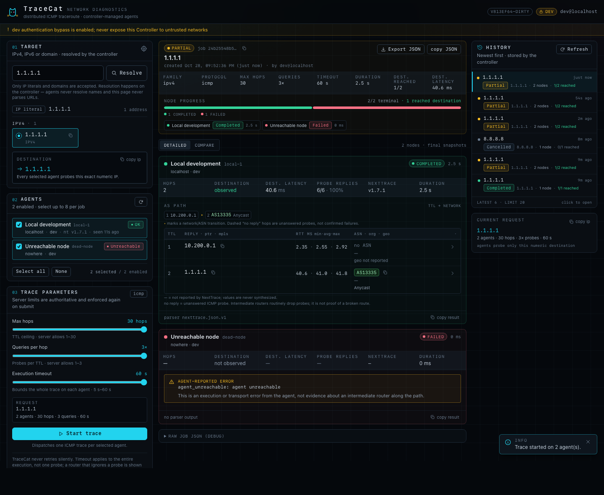
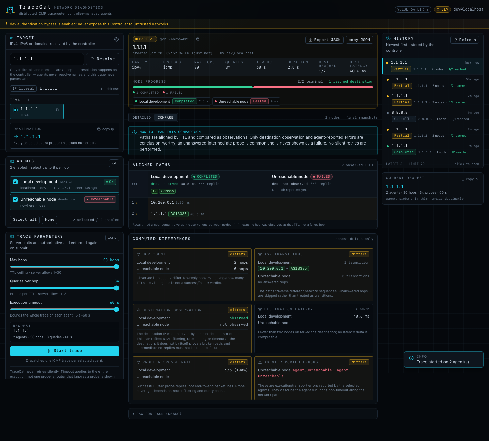
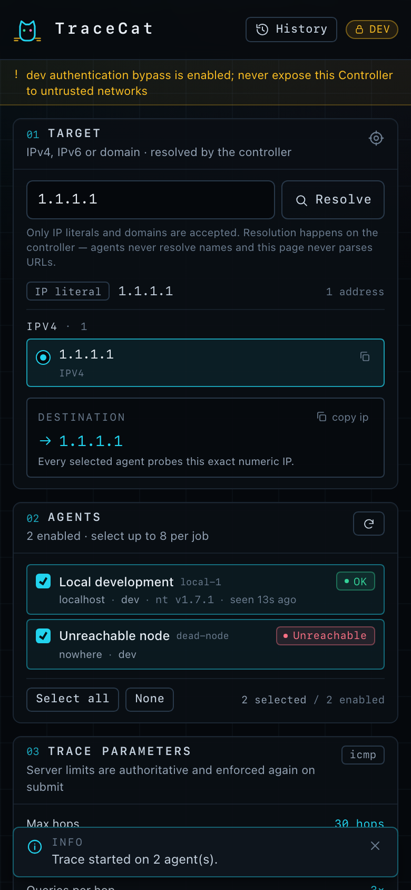

# TraceCat

**Secure, distributed traceroute from the web.** TraceCat is a lightweight
Controller + Agent system that runs the excellent
[NextTrace](https://github.com/nxtrace/NTrace-core) CLI on multiple vantage
points and turns the structured results into a fast, dark-mode dashboard with
side-by-side path comparison.

TraceCat is deliberately *not* a remote-execution platform. Agents execute one
fixed NextTrace binary with a strictly constructed argument vector; there is no
shell, no user-controlled executable or flags, and no generic command API.

```
 browser ──HTTPS/Cloudflare Access──> Controller ──HTTP over private network──> Agents ──> nexttrace
                                      (Go + SQLite)      (Go, unprivileged)
```



<details>
<summary>More screenshots (comparison view and mobile layout)</summary>





</details>

## Highlights

- **Typed, shell-free execution.** Targets are parsed as numeric IP literals;
  argv is built from a typed struct and asserted against an allowlist.
- **Defense in depth on targets.** Controller and every Agent independently
  enforce a default-deny IP policy (global unicast only) with an explicit
  admin CIDR allowlist for lab ranges. IPv4-mapped IPv6 bypasses are closed.
- **Authenticated at the application boundary.** Cloudflare Access JWTs are
  verified against the team JWKS (signature/issuer/audience/expiry); local
  password sessions use PBKDF2 + HttpOnly/SameSite cookies + CSRF. An explicit
  loopback-only dev mode exists for development.
- **DNS resolved once, centrally.** A/AAAA + IDN, deduplicated, policy-filtered;
  multiple addresses are always presented as an explicit choice, and only the
  selected numeric IP is sent to Agents.
- **ICMP, TCP and UDP probes.** Protocols are a fixed enum mapped to
  capability-detected NextTrace flags; TCP/UDP require an explicit destination
  port bounded to 1..65535, and each layer enforces its own protocol allowlist.
- **Interface selection.** Agents advertise eligible network interfaces
  (loopback and container/bridge devices excluded) so each node can trace from
  a chosen source interface; automatic OS routing remains the default.
- **Honest results.** Per-node Pending/Running/Completed/Failed/Timed out/
  Cancelled, bounded history, raw JSON export, and a UI that never claims an
  intermediate timeout means a broken route.
- **Small and maintainable.** Go stdlib-first (only `x/net/idna` and pure-Go
  SQLite as dependencies), one React/Tailwind dashboard embedded into the
  Controller binary, no Node at runtime.

## Repository layout

| Path | Contents |
| --- | --- |
| `cmd/tracecat-controller`, `internal/controller` | Web/API server, DNS, auth, job scheduler, SQLite history, SSE |
| `cmd/tracecat-agent`, `internal/agent` | Private-network, token-authenticated trace runner with per-interface selection |
| `internal/nexttrace` | Capability detection, typed command builder, version-aware JSON parser |
| `internal/ipguard` | Shared destination policy (default-deny + admin allowlist) |
| `internal/model` | Versioned wire contract |
| `internal/webui`, `web` | Embedded dashboard and its React/TS/Tailwind sources |
| `deploy`, `configs`, `docs` | installer, systemd units, Docker, private-networking/Cloudflare guidance, API and security docs |

## Quick start

On a Linux host with systemd and [NextTrace](https://github.com/nxtrace/NTrace-core)
installed, one command installs a loopback-only Controller + Agent and prints
the dashboard URL and login password:

```bash
curl -fsSL https://raw.githubusercontent.com/dotfrankruan/TraceCat/main/deploy/quickstart.sh | sudo bash
```

That is the whole setup for a single-host trial. For development from source:

```bash
make build
TRACECAT_AGENT_TOKEN=local-dev-token-please-change ./bin/tracecat-agent -config configs/agent.dev.json
./bin/tracecat-controller -config configs/controller.dev.json   # http://127.0.0.1:8080
```

Node.js is only needed if you rebuild the dashboard (`make ui`); release
artifacts are single Go binaries.

See **[QUICKSTART.md](QUICKSTART.md)** for the walkthrough, then
[docs/DEPLOYMENT.md](docs/DEPLOYMENT.md) for multi-host/private-network
deployment and optional Cloudflare Access, [docs/API.md](docs/API.md) for the
wire contract, [`SECURITY.md`](SECURITY.md) for the threat model, and
[docs/VERIFICATION.md](docs/VERIFICATION.md) for the independent real-host
verification report.

## Production topology

1. Controller on a small host or container, listener on `127.0.0.1:8080`.
2. `cloudflared` tunnel exposing the Controller hostname, protected by a
   Cloudflare Access application (MFA). TraceCat verifies the Access JWT itself.
3. Agents on each vantage point, bound to an explicit **private** address
   (any overlay/VPC; Tailscale is optional and no tags are used), reachable only
   by the Controller, each with its own bearer token. Agents advertise eligible
   network interfaces so the dashboard can select the source interface per node.
4. NextTrace installed on each Agent host; the Agent runs unprivileged with only
   `CAP_NET_RAW`.

## Verified environment

- Go 1.27.x toolchain; NextTrace v1.7.1 (macOS) and v1.7.3 (Debian 13) verified
  for flag detection and JSON parsing; the parser tolerates known schema
  variations.
- Deployed and independently verified on Debian 13 with systemd 257 and a
  private overlay (Tailscale was used only as the test overlay; no tags):
  329 PASS / 0 FAIL / 2 environment-N/A SKIPs, including real
  ICMP traces from two tailnet Agents, local-auth/CSRF checks and a
  zero-violation-CSP browser run (`docs/VERIFICATION.md`).
- Tests do not require public traceroute targets, real GeoIP services, or
  internet access.

See [docs/TESTING.md](docs/TESTING.md) for exactly what is verified, and
[docs/VERIFICATION.md](docs/VERIFICATION.md) for the independent Debian/
Tailscale deployment and security verification report (PASS/FAIL checks,
browser screenshots).

## Limitations (MVP)

- One-shot ICMP, TCP and UDP traceroute with bounded destination ports; MTR
  sessions are intentionally not exposed.
- Single-tenant: every authenticated user may use all configured nodes.
- No resumable jobs after a Controller restart; bounded history only.
- Agent transport is cleartext HTTP inside the private overlay/VPC (e.g.
  WireGuard/Tailscale); use TLS in front of Agents only if traffic crosses an
  untrusted network.
- Geolocation/ASN data comes from NextTrace's third-party providers and may be
  missing or inaccurate; missing values are never invented.
- Intermediate probe timeouts are not evidence of a broken path.

## License and attribution

TraceCat is licensed under the [Apache License 2.0](LICENSE).
NextTrace is an independent GPL-3.0 project, invoked as an external binary and
not vendored or modified; see [NOTICE](NOTICE) for attribution and operator
obligations.
