# TraceCat — independent deployment and security verification

This report is written by an **independent verifier** working on the shared
checkout but not on the production code. Every result below was reproduced from
a real Debian host with the repository's own binaries, service units and
configuration formats; implementer claims were treated as hypotheses until they
were observed. The verifier did not modify production Go/TypeScript/config
files, `go.mod`/`go.sum` or git state. The verification harness and captured
artifacts live under `verify/`.

| Phase | Scope | Status |
| --- | --- | --- |
| 1 | Agent: unprivileged systemd deployment on the tailnet, real NextTrace execution, adversarial HTTP matrix | **PASS** (126 PASS / 0 FAIL / 1 informational SKIP) |
| 2 | Controller + dashboard end-to-end over an SSH tunnel: DNS, multi-node jobs, SSE, export, history, cancellation, restart reconciliation, allowlist, local auth/CSRF/sessions, headless-Chrome screenshots | **PASS** (125 + 61 + 17 PASS / 0 + 0 + 0 FAIL, 1 N/A) |
| v0.1.1 delta (§13) | TCP/UDP + bounded ports, per-node interface selection, generic private bind policy, one-command installer + local release packaging | **PASS** (408 PASS / 0 FAIL / 3 informational SKIP) |
| v0.1.2 delta (§14) | Automatic Agent enrollment (Controller `--enrollment`, Agent `--controller`, no machine list) | **PASS** (80 + 12 browser checks / 0 FAIL) |
| **Total** | | **329 PASS / 0 FAIL / 2 SKIP** |

## 0. Environment and artifacts

| Item | Value |
| --- | --- |
| Final verified commit | `28f38f4b99558814ce604ae4f596a6f90e6dc738` (`28f38f4`). Delta over `4e3aa59`: Controller `429` responses now send `Retry-After: 1` and local-mode `POST /api/v1/auth/login` requires `Content-Type: application/json` (`415` otherwise) — only `internal/controller/api.go` and `internal/controller/httputil.go` changed; Agent code is unchanged (empty `git diff 4e3aa59..28f38f4 -- internal/agent internal/nexttrace cmd/tracecat-agent deploy/systemd/tracecat-agent.service`). Repository HEAD when this report was written is `feb0f1ae73597bcc4db5fa73f1c5c22582a90192` (docs-only `README.md` commit; `git diff 28f38f4..HEAD` touches only `README.md`), so the verified binaries correspond to the final compiled code. |
| Working tree | tracked production files clean; the only modifications are verifier-owned (`verify/` delta harness, refreshed screenshots and this report), committed with the delta. |
| Verified binaries | rebuilt from `28f38f4` with `CGO_ENABLED=0 GOOS=linux GOARCH=amd64 go build -trimpath` and redeployed: agent `sha256 2d19a524810bbaf6…` (source identical to `4e3aa59`; hash differs only by build/VCS stamping), controller `sha256 4fd42e28e0a4d3ac…` |
| Final runs | Agent matrix 2026-10-28T14:18:41Z (at 4e3aa59; agent code unchanged); Controller matrix 2026-10-28T14:27:34Z; local-auth 2026-10-28T14:28:00Z; browser proof 2026-10-28T14:30:47Z |
| Test host | `root@124.222.154.86` — Debian 13, kernel `6.12.95+deb13-amd64`, systemd `257.13-1~deb13u1`, Tailscale `1.104.4` |
| Tailnet addresses | IPv4 `100.81.98.125`, IPv6 `fd7a:115c:a1e0::4d2f:627e` |
| NextTrace | `v1.7.3 2026-08-23T16:13:15Z 40ac803`, `sha256 aa75440fcdee46c1…` |
| Agent services | `tracecat-agent` → node `debian-test-1`, listen `100.81.98.125:8443`; `tracecat-agent-b` → node `debian-test-2`, listen `100.81.98.125:8444` (distinct token) |
| Controller services | `tracecat-controller` → dev auth, `127.0.0.1:8080`, `public_origin http://127.0.0.1:18090`; `tracecat-controller-local` → local auth, `127.0.0.1:8081` (independent test instance) |
| Database | `/var/lib/tracecat/controller.db` and `controller-local.db`, `0600 tracecat`, SQLite WAL |
| Browser | headless Google Chrome 156 on macOS arm64, driven over the DevTools Protocol through `ssh -N -L 18090:127.0.0.1:8080` |
| Harness | `verify/setup-testhost-agent.sh`, `verify/setup-testhost-fullstack.sh`, `verify/agent-remote-verify.sh`, `verify/controller-remote-verify.sh`, `verify/controller-localauth-verify.sh`, `verify/check_trace_response.py`, `verify/e2e/drive.mjs`; screenshots in `verify/screenshots/`, trace samples in `verify/artifacts/` |

Note on the tunnel port: an unrelated local Controller already occupied
`127.0.0.1:18080` on the verification Mac, so the tunnel and the Controller's
`public_origin` use `18090` instead (same mechanism; no unrelated process was
disturbed). This is a test-environment detail only.

Topology:

```text
macOS (headless Chrome + CDP)                 Debian test host (root@124.222.154.86)
                                                ┌──────────────────────────────────────────────┐
  ssh -N -L 18090:127.0.0.1:8080 ─────────────► │ tracecat-controller (uid tracecat)           │
  http://127.0.0.1:18090 (browser origin)       │   dev auth, 127.0.0.1:8080, public_origin     │
                                                │   http://127.0.0.1:18090, SQLite history     │
                                                │      │ HTTP over the tailnet                 │
                                                │      ├─► tracecat-agent   A  100.81.98.125:8443 │
                                                │      └─► tracecat-agent-b B  100.81.98.125:8444 │
                                                │             └─ nexttrace (CAP_NET_RAW, own PG) │
                                                │ tracecat-controller-local (local auth :8081) │
                                                └──────────────────────────────────────────────┘
```

## 1. Verdict

Both phases are **PASS**. Totals across the three suites and the browser proof:
**329 PASS, 0 FAIL, 2 SKIP**. Three
blocking defects were found during Phase 1, reported with minimal
reproductions, fixed upstream and independently re-verified; no blocking defect
was found in Phase 2.

Phase 1 (Agent):

- binds only the configured Tailscale address — no wildcard, no public
  listener, and fails closed on wildcard/missing/non-Tailscale addresses;
- the bearer token is required for every request, compared in constant time,
  never echoed, logged or returned; the secret file is `0600 root:root`;
- the unprivileged `nexttrace` child really has `CAP_NET_RAW`
  (`CapEff=0x2000`), the exact fixed argv, a minimal environment and its own
  process group — real ICMP traces to IPv4 and IPv6 targets complete and are
  parsed into hops, with ASN/geo/PTR metadata and no banner/ANSI/HTML leakage;
- shell/argument/SSRF injection, IPv4-mapped IPv6, zoned addresses, malformed
  and oversized JSON, wrong schema/node/family/limits, oversized bodies, wrong
  `Content-Type`, burst rate limits and concurrency limits are all rejected as
  specified; no child process ran and no file was created for rejected targets;
- cancellation and graceful shutdown reap the entire process group; the journal
  contains no token, config path or binary path.

Phase 2 (Controller + dashboard):

- deployed from `28f38f4` with the repository's systemd unit and embedded
  dashboard; both tailnet Agents report `health: ok` with NextTrace v1.7.3;
- central DNS resolution returns real A/AAAA answers (e.g. `example.com` → 2×IPv4
  + 2×IPv6, explicit selection required) with the CDN/GeoDNS warning;
- a real multi-node job runs on both Agents (`completed`, 14 hops each,
  destination reached, `one.one.one.one` PTR surfaced through the new Hostname
  fix), is streamed as bare SSE snapshots, exported with bounded raw results,
  persisted across restarts and cancelled with both Agent process groups reaped;
- startup reconciliation marks jobs interrupted by a crash as `failed` (no
  stale `running` rows); the administrator allowlist is enforced (default deny,
  `0.0.0.0/0` and malformed CIDRs refuse startup);
- local auth mode: PBKDF2 login, `HttpOnly; SameSite=Strict` session cookie,
  CSRF + Origin/`Sec-Fetch-Site` enforcement, logout revocation, hashed
  sessions persisted in SQLite, per-client login/resolve/job rate limits;
- dev mode is loopback-only and rejects forwarding headers (`403`), the
  dashboard is served with a strict CSP and the other security headers, the
  frontend bundle contains no tokens or node addresses, and the browser run
  produced **zero CSP violations, zero console errors and zero uncaught
  exceptions** (see §12.5).

One caveat is environmental, not a defect: this provider filters some ICMP
TTL-exceeded replies, so many probes are honestly reported as `no_reply`
(see §9).

## 2. Method and independence

- Deployment was performed only with the verifier's own scripts
  (`verify/setup-testhost-agent.sh`) using the repo unit and example config
  layout. The Agent was built from the shared checkout; no local patches were
  applied to production code at any point.
- Verification was black-box: HTTP/curl, `ss`, `journalctl`, `/proc`, `systemd`
  and `pgrep`, plus source review of the security-critical paths
  (`internal/agent`, `internal/nexttrace`, `internal/ipguard`, `internal/model`).
- `verify/check_trace_response.py` validates every trace response independently
  (42 structural/sanitization/bounds checks per trace) instead of trusting the
  Agent's self-reported status.
- The deployed rate limit (`burst=10`, `60 req/min`) is intentionally low; the
  harness restarts the service between request batches to avoid the rate limiter
  masking functional assertions, and tests the burst limit deliberately in §G.
  Restarting also demonstrates restart resilience.
- Three defects were found and reported with minimal reproductions; the owning
  engineer/Lead fixed them upstream and the verifier rebuilt, redeployed and
  re-ran the full matrix.

### Threats explicitly exercised

| Threat | Exercised by |
| --- | --- |
| T1 remote code execution via destination | shell metacharacters, `$(id)`, backticks, flags, URL, port suffix |
| T2 argument/option injection | exact live argv audit of the child (`/proc/pid/cmdline`) |
| T3 SSRF/reconnaissance | private, CGNAT, link-local/metadata, loopback, multicast, documentation, unspecified, mapped, zoned |
| T4 IPv4-mapped IPv6 bypass | `::ffff:127.0.0.1` |
| T6 credential theft/impersonation | missing/wrong/scheme-wrong/prefix tokens, unknown path, journal/health leakage, child env |
| T9 stored/reflected XSS from metadata | control/ANSI/HTML scan over real hop metadata (incl. Chinese ISP names) |
| T10 DoS | 413 body cap, 415, 429 burst, 503 concurrency, 5 s header timeout, 16 KiB header cap, 4 MiB stdout cap |
| T11 secret leakage | token/file perms, health body, journal grep, `/proc/<child>/environ` |
| T12 orphaned children | cancellation, client disconnect, graceful shutdown, `pgrep` |

## 3. Deployment under test

Condensed from `verify/setup-testhost-agent.sh` (the script is the reproducible
source of truth; rerun it as root on a host where the checkout is available and
your ssh key is authorised):

```bash
# cross-compile on the Mac
CGO_ENABLED=0 GOOS=linux GOARCH=amd64 go build -trimpath \
  -o /tmp/tracecat-agent-linux-amd64 ./cmd/tracecat-agent

# install on the host (see verify/setup-testhost-agent.sh for the full script)
install -m 0755 tracecat-agent-linux-amd64 /usr/local/bin/tracecat-agent
install -d -m 0755 /etc/tracecat
install -m 0640 -o root -g tracecat agent.json /etc/tracecat/agent.json
# token generated on the host and never printed:
( umask 077; printf 'TRACECAT_AGENT_TOKEN=%s\n' \
    "$(openssl rand -base64 48 | tr -d '\n')" > /etc/tracecat/agent.env )
chmod 0600 /etc/tracecat/agent.env   # root:root
install -m 0644 tracecat-agent.service /etc/systemd/system/
systemctl daemon-reload && systemctl enable --now tracecat-agent
```

`/etc/tracecat/agent.json` as deployed (no secrets in the file):

```json
{
  "node_id": "debian-test-1",
  "name": "Debian test host (independent verification)",
  "listen": "100.81.98.125:8443",
  "auth": { "token_env": "TRACECAT_AGENT_TOKEN" },
  "nexttrace": {
    "binary": "/usr/local/bin/nexttrace",
    "max_concurrent_traces": 4,
    "probe_timeout_ms": 1000,
    "max_execution_ms": 60000,
    "max_stdout_bytes": 4194304,
    "max_raw_bytes": 1048576,
    "geo_provider": ""
  },
  "security": {
    "allow_private_targets": false,
    "allowed_cidrs": [],
    "require_tailscale_bind": true,
    "allow_non_tailscale_bind": false
  },
  "rate_limit": { "requests_per_minute": 60, "burst": 10, "max_concurrent_http": 16 },
  "log_level": "info"
}
```

Observed startup (journal, token/path-free):

```text
level=INFO msg="nexttrace detected" node_id=debian-test-1 nexttrace_version=v1.7.3 capabilities="[ipv4 ipv6 json max_hops queries timeout]"
level=INFO msg="agent listening" node_id=debian-test-1 listen=100.81.98.125:8443 nexttrace_available=true
```

Listener (the only 8443 listener; the public interface is not reachable —
`curl http://124.222.154.86:8443/...` returns no HTTP status):

```text
LISTEN 0 4096 100.81.98.125:8443 0.0.0.0:* users:(("tracecat-agent",pid=...,fd=3))
```

## 4. Defects found during verification (all fixed and re-verified)

| ID | Severity | Component | Symptom | Root cause | Fix (upstream) | Re-verified |
| --- | --- | --- | --- | --- | --- | --- |
| D1 | P1 | `deploy/systemd/tracecat-agent.service` | Agent started `degraded`; every trace returned `nexttrace_unavailable` | `MemoryDenyWriteExecute=true` made real NextTrace v1.7.3 exit `SIGSEGV` (ExecMainStatus=11, code=killed) | `c1fbfde` removes W^X from the Agent unit (Controller keeps it) and documents why | Yes — live trace + 126-check matrix |
| D2 | P1 | `internal/nexttrace/capabilities.go` | Agent `degraded`: "installed nexttrace does not support the flags TraceCat requires" | `helpFlagSet` truncated each help line at the first run of two spaces, i.e. exactly at the short/long alias separator in real pflag help (`-j  --json`), so `--json` was never detected | `c1fbfde` keeps scanning when the text after the gap is another flag; regression tests use real v1.7.3 help | Yes — health `status=ok`, capabilities include `json` |
| D3 | P1 | `internal/nexttrace/parser.go` | Real traces returned HTTP 200 but `status=failed`, `error.code=parse_error` ("output is not valid JSON") | NextTrace v1.7.x writes a 514-byte, 3-line raw-socket privilege advisory to **stdout** before the JSON whenever it runs unprivileged, even with `--json` and even when `CAP_NET_RAW` is effective | `a2833e4` finds a complete valid JSON document within a bounded 16 KiB prefix (max 16 candidates); banner never stored/exported; truncated JSON still `parse_error` | Yes — real traces `completed`, raw result contains no banner |

Minimal reproductions (kept for the record; all were run by the verifier before
the fixes):

```bash
# D1 — SIGSEGV under W^X
cat >/etc/systemd/system/tc-probe.service <<'UNIT'
[Service]
Type=oneshot
User=tracecat
NoNewPrivileges=true
MemoryDenyWriteExecute=true
ExecStart=/usr/local/bin/nexttrace --version
UNIT
systemctl start tc-probe.service
systemctl show -p ExecMainStatus --value tc-probe.service   # 11
journalctl -u tc-probe.service -o cat | grep -i segv        # status=11/SEGV

# D2 — real help format (before fix)
nexttrace --help | awk '{t=$0; sub(/^[ 	]+/,"",t); if (t ~ /^-/) print}' | grep -- '--json'
#   -j  --json   Output trace results as JSON      <- two spaces, not a comma

# D3 — advisory on stdout, JSON after it (before fix)
sudo -u tracecat env -i PATH=/usr/local/bin:/usr/bin:/bin HOME=/var/lib/tracecat \
  LANG=C LC_ALL=C NO_COLOR=1 /usr/local/bin/nexttrace -4 --json -q 1 -m 1 1.1.1.1 \
  > /tmp/nt.out 2>/tmp/nt.err
python3 - <<'PY'
import json
data = open('/tmp/nt.out','rb').read()
print(data.find(b'{"Hops"'))        # 514: banner precedes the JSON
print(len(data), open('/tmp/nt.err','rb').read())  # 724, b'' (stderr empty)
PY
```

### Non-blocking observations

- `nexttrace binary is not executable` was the reported error for a probe killed
  by a signal (D1). Behaviour is safe but the diagnostic is imprecise; a
  follow-up could distinguish signal exits from permission errors.
- The host mounts `/tmp` with `nosuid`, so a `setcap` binary copied to `/tmp`
  silently loses its file capability. Operators using the documented `setcap`
  alternative must install NextTrace at its final path (e.g.
  `/usr/local/bin/nexttrace`). Worth a sentence in the deployment docs.
- The Agent binds only the IPv4 tailnet address (as configured); the host's
  tailnet IPv6 ULA `fd7a:…` is not exposed. Acceptable, but a dual-stack
  deployment needs a second `listen`/instance today.
- The cross-compiled binary reports `version="dev"` because no `-ldflags` version
  is injected by the ad-hoc build command. Release builds should set it;
  harmless for verification.
- Reverse DNS was initially missing because the parser ignored NextTrace's
  top-level `Hostname` field (observed during Phase 1). Fixed in `4e3aa59`
  and re-verified in Phase 2: the destination hop of `1.1.1.1` now carries
  `ptr: one.one.one.one` end-to-end through both Agents.
- Rate limits are in-memory per Agent and reset on restart (documented design).

## 5. Verification matrix (Phase 1)

Run at `4e3aa59`: **126 PASS, 0 FAIL, 1 SKIP** (127 recorded checks; the SKIP is an informational network-capability probe, not a product check). The matrix was not re-run for the `28f38f4` delta because no Agent/NextTrace code changed (`git diff 4e3aa59..28f38f4 -- internal/agent internal/nexttrace cmd/tracecat-agent deploy/systemd/tracecat-agent.service` is empty).
Rows marked `real_trace_*_contract` each aggregate the independent wire-contract
checks from `verify/check_trace_response.py`.

#### A. deployment posture

| # | Check | Expected | Observed | Result |
|---|---|---|---|---|
| A1 | `unit_enabled` | enabled | `enabled` | PASS |
| A2 | `unit_active` | active | `active` | PASS |
| A3 | `runs_as_unprivileged` | User=tracecat | `tracecat` | PASS |
| A4 | `no_new_privileges` | yes | `yes` | PASS |
| A5 | `ambient_cap_net_raw` | cap_net_raw | `cap_net_raw` | PASS |
| A6 | `capability_bounding_set` | cap_net_raw | `cap_net_raw` | PASS |
| A7 | `protect_system` | strict | `strict` | PASS |
| A8 | `private_tmp` | yes | `yes` | PASS |
| A9 | `memory_deny_write_execute` | disabled (nexttrace needs W+X or it SIGSEGVs) | `no` | PASS |
| A10 | `binds_only_tailscale_ip` | single 100.81.98.125:8443 | `100.81.98.125:8443` | PASS |
| A11 | `no_wildcard_bind` | no 0.0.0.0/:: listener | `100.81.98.125:8443` | PASS |
| A12 | `not_reachable_on_public_ip` | no HTTP 200 on public IP | `code=000` | PASS |
| A13 | `config_permissions` | 640 root:tracecat | `640 root:tracecat` | PASS |
| A14 | `secret_file_permissions` | 600 root:root | `600 root:root` | PASS |
| A15 | `token_entropy_length` | >=32 bytes | `len=64` | PASS |
| A16 | `agent_process_user` | tracecat | `tracecat` | PASS |

#### B. authentication

| # | Check | Expected | Observed | Result |
|---|---|---|---|---|
| B1 | `auth_missing_token` | 401 | `401 unauthorized` | PASS |
| B2 | `auth_challenge_header` | WWW-Authenticate: Bearer | `Bearer` | PASS |
| B3 | `auth_wrong_token` | 401 | `401 unauthorized` | PASS |
| B4 | `auth_wrong_scheme` | 401 | `401 unauthorized` | PASS |
| B5 | `auth_empty_bearer` | 401 | `401 unauthorized` | PASS |
| B6 | `auth_before_routing` | 401 on unknown path without token | `401` | PASS |
| B7 | `health_with_token` | 200 | `200` | PASS |
| B8 | `health_schema` | tracecat.agent.v1 | `tracecat.agent.v1` | PASS |
| B9 | `health_status_ok` | ok (nexttrace usable) | `ok nexttrace.available=True err=` | PASS |
| B10 | `health_node_id` | debian-test-1 | `debian-test-1` | PASS |
| B11 | `health_limits` | max_timeout_ms=60000 max_concurrent=4 | `60000/4` | PASS |
| B12 | `health_time_format` | RFC3339Nano | `ok` | PASS |
| B13 | `health_no_secret_or_path_leak` | no token/path/env | `none` | PASS |
| B14 | `security_headers` | application/json + nosniff + no-store | `Cache-Control: no-store;Content-Type: application/json;X-Content-Type-Options: nosniff` | PASS |

#### C. HTTP method handling

| # | Check | Expected | Observed | Result |
|---|---|---|---|---|
| C1 | `trace_get_method` | 405 | `405 Allow=POST` | PASS |
| C2 | `health_post_method` | 405 | `405 Allow=GET` | PASS |
| C3 | `trace_put_method` | 405 | `405 Allow=POST` | PASS |
| C4 | `unauth_unaffected_by_method_check` | 401 first | `401` | PASS |

#### D. strict JSON / schema / limits

| # | Check | Expected | Observed | Result |
|---|---|---|---|---|
| D1 | `valid_request_reaches_trace` | 200 (terminal status inside) | `200 status=completed err=` | PASS |
| D2 | `json_unknown_field` | 400 invalid_request | `400 invalid_request` | PASS |
| D3 | `json_trailing_data` | 400 invalid_request | `400 invalid_request` | PASS |
| D4 | `wrong_schema_version` | 400 unsupported_schema_version | `400 unsupported_schema_version` | PASS |
| D5 | `bad_job_id` | 400 | `400 invalid_request` | PASS |
| D6 | `wrong_node_id` | 403 forbidden | `403 forbidden` | PASS |
| D7 | `bad_family` | 400 | `400 invalid_request` | PASS |
| D8 | `bad_protocol` | 400 (tcp not in MVP) | `400 invalid_request` | PASS |
| D9 | `max_hops_zero` | 400 | `400 invalid_request` | PASS |
| D10 | `max_hops_above_global_max` | 400 | `400 invalid_request` | PASS |
| D11 | `queries_zero` | 400 | `400 invalid_request` | PASS |
| D12 | `queries_above_global_max` | 400 | `400 invalid_request` | PASS |
| D13 | `timeout_below_min` | 400 | `400 invalid_request` | PASS |
| D14 | `timeout_above_agent_max` | 400 (agent max 60000) | `400 invalid_request` | PASS |
| D15 | `family_target_mismatch` | 400 | `400 invalid_request` | PASS |

#### E. target rejection (injection / SSRF policy)

| # | Check | Expected | Observed | Result |
|---|---|---|---|---|
| E1 | `inject_reject[hostname]` | 4xx target_rejected/invalid_request | `422 target_rejected` | PASS |
| E2 | `inject_reject[semicolon_cmd]` | 4xx target_rejected/invalid_request | `422 target_rejected` | PASS |
| E3 | `inject_reject[dollar_paren]` | 4xx target_rejected/invalid_request | `422 target_rejected` | PASS |
| E4 | `inject_reject[backticks]` | 4xx target_rejected/invalid_request | `422 target_rejected` | PASS |
| E5 | `inject_reject[flag_help]` | 4xx target_rejected/invalid_request | `422 target_rejected` | PASS |
| E6 | `inject_reject[flag_family]` | 4xx target_rejected/invalid_request | `422 target_rejected` | PASS |
| E7 | `inject_reject[flag_output]` | 4xx target_rejected/invalid_request | `422 target_rejected` | PASS |
| E8 | `inject_reject[bracketed_v6]` | 4xx target_rejected/invalid_request | `422 target_rejected` | PASS |
| E9 | `inject_reject[zoned_v6]` | 4xx target_rejected/invalid_request | `422 target_rejected` | PASS |
| E10 | `inject_reject[mapped_v6]` | 4xx target_rejected/invalid_request | `400 invalid_request` | PASS |
| E11 | `inject_reject[private_10]` | 4xx target_rejected/invalid_request | `422 target_rejected` | PASS |
| E12 | `inject_reject[private_172]` | 4xx target_rejected/invalid_request | `422 target_rejected` | PASS |
| E13 | `inject_reject[private_192]` | 4xx target_rejected/invalid_request | `422 target_rejected` | PASS |
| E14 | `inject_reject[metadata_linklocal]` | 4xx target_rejected/invalid_request | `422 target_rejected` | PASS |
| E15 | `inject_reject[documentation_203]` | 4xx target_rejected/invalid_request | `422 target_rejected` | PASS |
| E16 | `inject_reject[documentation_198]` | 4xx target_rejected/invalid_request | `422 target_rejected` | PASS |
| E17 | `inject_reject[cgnat_100_64]` | 4xx target_rejected/invalid_request | `422 target_rejected` | PASS |
| E18 | `inject_reject[unspecified]` | 4xx target_rejected/invalid_request | `422 target_rejected` | PASS |
| E19 | `inject_reject[multicast]` | 4xx target_rejected/invalid_request | `422 target_rejected` | PASS |
| E20 | `inject_reject[loopback_v6]` | 4xx target_rejected/invalid_request | `422 target_rejected` | PASS |
| E21 | `inject_reject[documentation_v6]` | 4xx target_rejected/invalid_request | `422 target_rejected` | PASS |
| E22 | `inject_reject[with_port]` | 4xx target_rejected/invalid_request | `422 target_rejected` | PASS |
| E23 | `inject_reject[url]` | 4xx target_rejected/invalid_request | `422 target_rejected` | PASS |
| E24 | `inject_reject[trailing_space]` | 4xx target_rejected/invalid_request | `422 target_rejected` | PASS |
| E25 | `inject_reject[newline]` | 4xx target_rejected/invalid_request | `400 invalid_request` | PASS |
| E26 | `no_injection_side_effect` | /tmp/tracecat-pwned absent | `absent` | PASS |
| E27 | `no_child_ran_for_rejected_targets` | no nexttrace process | `none` | PASS |
| E28 | `allowed_target_still_reaches_runner` | 200 | `200 status=completed` | PASS |

#### F. content type and body size

| # | Check | Expected | Observed | Result |
|---|---|---|---|---|
| F1 | `content_type_text_plain` | 415 | `415 invalid_request` | PASS |
| F2 | `content_type_missing` | 415 | `415 invalid_request` | PASS |
| F3 | `content_type_with_charset` | 200 | `200 status=completed` | PASS |
| F4 | `body_over_64kib` | 413 payload_too_large | `413 payload_too_large size=71904` | PASS |
| F5 | `empty_body` | 400 | `400 invalid_request` | PASS |

#### G. rate limiting

| # | Check | Expected | Observed | Result |
|---|---|---|---|---|
| G1 | `burst_rate_limit` | >=1x 429 among 16 rapid requests | `codes=200 200 200 200 200 200 200 200 200 200 429 429 429 429 429 429` | PASS |
| G2 | `rate_limit_envelope` | 429 rate_limited | `429 rate_limited retry_after=1` | PASS |
| G3 | `rate_limit_retry_after` | numeric seconds | `1` | PASS |

#### H. platform caveat: ICMP reachability from this vantage point

| # | Check | Expected | Observed | Result |
|---|---|---|---|---|
| H1 | `icmp_ttl_exceeded_available` | informational | `ping -t 1: 1 packets transmitted, 0 received, 100% packet loss, time 0ms` | SKIP (not applicable) |

#### I. real traces and capability proof

| # | Check | Expected | Observed | Result |
|---|---|---|---|---|
| I1 | `real_trace_ipv4_http` | 200 | `200` | PASS |
| I2 | `real_trace_ipv4_contract` | all wire checks pass | `SUMMARY 44/44 checks passed` | PASS |
| I3 | `real_trace_ipv4_detail` | >=20 sub-checks | `SUMMARY 44/44 checks passed` | PASS |
| I4 | `real_trace_ipv6_http` | 200 | `200 status=completed` | PASS |
| I5 | `real_trace_ipv6_contract` | all wire checks pass | `SUMMARY 43/43 checks passed` | PASS |
| I6 | `cap_net_raw_effective` | CAP_NET_RAW set, uid tracecat | `uid=tracecat CapEff=0000000000002000 CapAmb=0000000000002000 net_raw=yes` | PASS |
| I7 | `child_env_minimal` | no token/config/env leak | `leak=none keys=HOME,LANG,LC_ALL,NO_COLOR,PATH` | PASS |
| I8 | `raw_socket_child_running` | nexttrace alive (no permission abort) | `pid=3614267` | PASS |
| I9 | `cancellation_kills_process_group` | no nexttrace within 12s of client disconnect | `reaped` | PASS |
| I10 | `cancellation_logged` | journal status=cancelled | `status=cancelled` | PASS |
| I11 | `agent_survives_cancel` | active | `active` | PASS |
| I12 | `concurrency_503` | 503 busy when 4 traces in flight | `503 busy children=4` | PASS |
| I13 | `agent_recovers_after_load` | 200 health | `200` | PASS |

#### J. startup refusal (fail closed, never wildcard)

| # | Check | Expected | Observed | Result |
|---|---|---|---|---|
| J1 | `startup_refuse[wildcard_v4]` | exit!=0 and mentions 'wildcard binds are refused' | `rc=1 error="listen: wildcard binds are refused; configure an explicit local address"` | PASS |
| J2 | `startup_refuse[wildcard_v6]` | exit!=0 and mentions 'wildcard binds are refused' | `rc=1 error="listen: wildcard binds are refused; configure an explicit local address"` | PASS |
| J3 | `startup_refuse[empty_host]` | exit!=0 and mentions 'wildcard binds are refused' | `rc=1 error="listen: wildcard binds are refused; configure an explicit local address"` | PASS |
| J4 | `startup_refuse[hostname]` | exit!=0 and mentions 'numeric IP address' | `rc=1 error="listen: listen host must be a numeric IP address (hostnames are not accepted)"` | PASS |
| J5 | `startup_refuse[unassigned_ip]` | exit!=0 and mentions 'is not assigned' | `rc=1 error="listen address 100.81.98.126 is not assigned to any local interface"` | PASS |
| J6 | `startup_refuse[non_tailscale_private]` | exit!=0 and mentions 'not a Tailscale address' | `rc=1 error="listen address 10.0.0.12 is not a Tailscale address; require_tailscale_bind is enabled"` | PASS |
| J7 | `startup_refuse[non_tailscale_public]` | exit!=0 and mentions 'is not assigned' | `rc=1 error="listen address 203.0.113.10 is not assigned to any local interface"` | PASS |
| J8 | `startup_refuse[lab_flag_missing]` | exit!=0 and mentions 'allow_non_tailscale_bind' | `rc=1 error="security.require_tailscale_bind=false requires security.allow_non_tailscale_bind=true for an explicit lab configuration"` | PASS |
| J9 | `startup_refuse[missing_token]` | exit!=0 and mentions 'is not set' | `rc=1 error="auth.token_env \"` | PASS |
| J10 | `startup_refuse[short_token]` | exit!=0 and mentions 'at least 16 characters' | `rc=1 error="auth.token_env \"` | PASS |
| J11 | `no_stray_listener_from_refusals` | only the main service listener on 8443 | `100.81.98.125:8443` | PASS |

#### K. restart resilience and journal hygiene

| # | Check | Expected | Observed | Result |
|---|---|---|---|---|
| K1 | `restart_active` | active | `active` | PASS |
| K2 | `restart_bind_unchanged` | 100.81.98.125:8443 | `100.81.98.125:8443` | PASS |
| K3 | `restart_auth_and_health` | 200 with token | `200` | PASS |
| K4 | `restart_still_requires_token` | 401 without token | `401` | PASS |
| K5 | `journal_no_secret_or_path_leak` | no token/config path/binary path | `none` | PASS |
| K6 | `journal_clean_no_warn_error` | no WARN/ERROR lines | `` | PASS |

#### L. graceful shutdown reaps in-flight traces

| # | Check | Expected | Observed | Result |
|---|---|---|---|---|
| L1 | `child_running_before_shutdown` | >=1 nexttrace child | `children=1` | PASS |
| L2 | `shutdown_reaps_children` | service stopped, no orphan nexttrace | `stopped=1 orphans=none` | PASS |
| L3 | `shutdown_logged` | journal 'shutdown requested; cancelling in-flight traces' | `shutdown requested; cancelling in-flight traces` | PASS |
| L4 | `healthy_after_shutdown_cycle` | 200 | `200` | PASS |

#### M. transport hardening (slowloris / header size / auth edges)

| # | Check | Expected | Observed | Result |
|---|---|---|---|---|
| M1 | `read_header_timeout_5s` | connection closed by server ~5s on incomplete headers | `closed_after=5.0s bytes=0` | PASS |
| M2 | `max_header_bytes` | 431 for ~40KiB header | `code=431` | PASS |
| M3 | `auth_token_prefix_rejected` | 401 | `401` | PASS |
| M4 | `auth_scheme_case_insensitive` | 200 (RFC 7235 scheme is case-insensitive) | `200` | PASS |
| M5 | `unknown_path_with_token` | 404 not_found | `404 not_found` | PASS |
| M6 | `head_not_allowed` | 405 | `code=405` | PASS |
| M7 | `left_running_for_phase2` | active | `active` | PASS |

## 6. Real trace evidence (IPv4 and IPv6)

Command template (token read from the `0600` env file on the host; never printed):

```bash
TOKEN=$(sed -n 's/^TRACECAT_AGENT_TOKEN=//p' /etc/tracecat/agent.env)
curl -sS -m 120 -H "Authorization: Bearer $TOKEN" -H 'Content-Type: application/json' \
  --data-binary '{"schema_version":"tracecat.agent.v1",
                  "job_id":"<32 hex>","node_id":"debian-test-1",
                  "target_ip":"1.1.1.1","family":"ipv4","protocol":"icmp",
                  "max_hops":40,"queries":1,"timeout_ms":60000}' \
  http://100.81.98.125:8443/v1/trace
```

IPv4 (`1.1.1.1`, `max_hops=40`) — **completed, destination reached**; full
response kept in `verify/artifacts/trace-ipv4-1.1.1.1.json`:

```json
{"status":"completed",
 "summary":{"hop_count":14,"reached_destination":true,"destination_rtt_ms":191.546,
            "replies":7,"probes":14},
 "parser_schema":"nexttrace.json.v1","nexttrace_version":"v1.7.3",
 "raw_result":{"Hops":[[{"Success":true,"Address":{"IP":"11.82.200.193","Zone":""}, ...}]]}}
```

Representative hops observed (success, address, rtt, asn, country):
`11.82.200.193 1.129ms`, `10.200.77.117 2.799ms`,
`101.226.210.81 2.441ms AS4812 China`, `202.97.35.86 6.666ms AS4134 China`,
`172.69.117.60 66.984ms AS13335 Singapore`, `1.1.1.1 191.546ms AS13335 Anycast`.
The response is 7.0 KiB, `raw_result` is 4,571 bytes of pure JSON (no advisory
text, no ANSI), well below `max_raw_bytes=1 MiB`.

IPv6 (`2606:4700:4700::1111`, `max_hops=12`) — **completed**, 12 hops, 6 replies,
honest `reached_destination=false` because the unicast tail of the path does not
answer within the probe budget; sample in
`verify/artifacts/trace-ipv6-2606-4700-4700-1111.json`. Real metadata exercised
sanitization, including UTF-8 ISP names:

```json
{"success":true,"address":"2402:4e00:21b9:8017::1","rtt_ms":1.303,
 "asn":45090,"country":"China","region":"Beijing",
 "owner":"tencent.com","isp":"腾讯","lat":39.90420913696289,"lng":116.40739440917969}
```

`verify/check_trace_response.py` result for both artifacts: **42/42 checks** —
schema/status/family/target echo, canonical hop addresses, RTT bounds,
`no_reply` semantics (failed probes carry no address/RTT), summary consistency,
ASN/geo bounds, MPLS bound, `raw_result` bounded and untruncated, and no control
characters, ANSI escapes or HTML markup anywhere in the decoded strings. The
harness adds a 43rd check (bearer token absent from the response).

## 7. CAP_NET_RAW proof for the unprivileged child

Captured live while a real trace was running (`max_hops=40`, target `1.1.1.1`):

```text
child_pid=3594845
== cmdline (NUL->space) ==
/usr/local/bin/nexttrace -4 --json -q 1 -m 40 --timeout 1000 1.1.1.1
== executable ==
/usr/local/bin/nexttrace
== ps (pid,ppid,pgid,user,comm) ==
3594845 3594070 3594845 tracecat nexttrace
== parent agent pid ==
3594070 /usr/local/bin/tracecat-agent -config /etc/tracecat/agent.json
== status caps ==
CapPrm: 0000000000002000
CapEff: 0000000000002000
CapBnd: 0000000000002000
CapAmb: 0000000000002000
NoNewPrivs: 1
Seccomp: 2
== environ (NUL->newline) ==
PATH=/usr/local/bin:/usr/bin:/bin:/usr/sbin:/sbin
HOME=/var/lib/tracecat
LANG=C
LC_ALL=C
NO_COLOR=1
== trace -> completed {'hop_count': 14, 'reached_destination': True, ...}
```

Interpretation:

- `0x2000` is bit 13 = `CAP_NET_RAW`, present in permitted/effective/bounding and
  ambient sets, so the **unprivileged** child can open raw ICMP sockets without
  root, setuid or a `setcap` binary. `NoNewPrivs=1` and `Seccomp=2` show the
  systemd hardening is still active.
- The argv is exactly the typed vector: family, `--json`, `-q`, `-m`,
  `--timeout`, then the canonical target **last**. No shell, no request-derived
  string, no second positional argument.
- The child's process group id equals its pid (own group → group kill is
  effective), and its parent is the Agent.
- The environment is exactly the five fixed variables; the bearer token,
  TraceCat config and unrelated variables are absent.

## 8. Cancellation, concurrency and graceful shutdown

| Observation | Command / evidence | Result |
| --- | --- | --- |
| Client disconnect kills the process group | `timeout 2 curl … long trace`, then poll `pgrep nexttrace` | no child within 12 s; journal `status=cancelled error_code=cancelled`; Agent stays `active` |
| Concurrency limit | 4 long traces in flight, 5th request | `503 {"error":{"code":"busy"}}`; 4 children observed; health `200` afterwards |
| Graceful shutdown | long trace in flight, `systemctl stop tracecat-agent` | service stopped, no orphan `nexttrace`; journal `shutdown requested; cancelling in-flight traces`; healthy after restart |
| Restart resilience | `systemctl restart` | same single tailnet listener, `200` with token, `401` without |
| Stalled handshake | TCP connect + half a header, wait | connection closed after 5.0 s (`ReadHeaderTimeout=5s`) |
| Header flood | ~40 KiB request header | `431` (`MaxHeaderBytes=16 KiB`) |

## 9. Provider / network caveat (not a defect)

This vantage point's upstream filters ICMP TTL-exceeded for early hops:
`ping -c1 -t 1 1.1.1.1` loses 100 % while normal ICMP echo succeeds and IPv4/IPv6
`nexttrace` deep hops do get replies. Therefore some hops are legitimately
`success=false, error_code="no_reply"`. This must **not** be read as a broken
route: the IPv4 trace still reached `1.1.1.1` (14 hops, 7 replies, 191.5 ms) and
the dashboard copy already tells users that `no_reply` is normal. The verifier
records this explicitly so future runs are compared against the right baseline.

## 10. Residual risks and operator recommendations

- **Keep `MemoryDenyWriteExecute` off in the Agent unit.** It is intentional and
  commented; the Controller unit may keep it. Re-adding it silently breaks all
  traces (D1).
- **Retest after any NextTrace upgrade**: run
  `verify/agent-remote-verify.sh` (or at least `sudo -u tracecat nexttrace
  --json -q 1 -m 1 1.1.1.1` as the documented smoke test) and confirm
  `/v1/health` reports the new version and all capabilities. v1.7.x's stdout
  advisory is tolerated by the parser, but a future banner format change could
  still require a parser update.
- **Tailnet ACLs were not applicable in this phase** (no Controller tag existed
  yet); `deploy/tailscale/acl.hujson.example` must be applied before the
  Controller is trusted to reach port 8443. The Agent's own bearer token is the
  only application-layer authentication and it works, but ACLs are the second
  layer.
- **Token handling**: env file `0600 root:root`, referenced by name only; root on
  the host can read it (accepted limitation), so keep the host hardened and
  rotate tokens on a schedule.
- **Cleartext HTTP on the tailnet** is by design (WireGuard provides transport
  security) — do not expose port 8443 on a public interface; the Agent will not
  bind one.
- **In-memory rate limits** reset on restart and are not shared between Agents
  (documented design); don't rely on them as a billing boundary.
- **PIDs/uptime leaks**: none observed; health/error bodies contain no paths,
  environment or stderr.

## 11. Reproducing this run

```bash
# 1. build + deploy the Agent (from the shared checkout, key-based ssh to the host)
TESTHOST=root@124.222.154.86 verify/setup-testhost-agent.sh

# 2. copy the harness to the host and run it as root
scp verify/agent-remote-verify.sh verify/check_trace_response.py \
    root@124.222.154.86:/root/tc-verify/
ssh root@124.222.154.86 'bash /root/tc-verify/agent-remote-verify.sh'
# expected tail: ===== SUMMARY: 126 PASS, 0 FAIL, 1 SKIP =====

# 3. optional: validate a saved trace response offline
python3 verify/check_trace_response.py verify/artifacts/trace-ipv4-1.1.1.1.json \
        --family ipv4 --target 1.1.1.1
```

The harness prints one `CHECK / expected / observed / PASS|FAIL` line per check
and a TSV file at `/tmp/tracecat-verify-results.tsv` for auditing. It contains no
secrets: the token is read from `/etc/tracecat/agent.env` on the host and passed
to `curl` via a mode-0600 config file, never on the command line or in output.

## 12. Phase 2 — Controller + dashboard + local auth

### 12.1 Deployment under test

Deployed with `verify/setup-testhost-fullstack.sh` (builds both binaries on the
Mac, ships them with the repo units, generates secrets on the host):

```bash
# cross-compile (no CGO, no Node needed: dashboard assets are committed)
CGO_ENABLED=0 GOOS=linux GOARCH=amd64 go build -trimpath -o /tmp/tracecat-agent ./cmd/tracecat-agent
CGO_ENABLED=0 GOOS=linux GOARCH=amd64 go build -trimpath -o /tmp/tracecat-controller ./cmd/tracecat-controller

SKIP_BUILD=1 verify/setup-testhost-fullstack.sh
```

- Controller unit: repo `deploy/systemd/tracecat-controller.service`,
  **unmodified** (`User=tracecat`, `MemoryDenyWriteExecute=true`,
  `ProtectSystem=strict`, `CapabilityBoundingSet=`, `StateDirectory=tracecat`).
  The Controller runs fine under W^X (unlike the Agent, which execs NextTrace).
- Config: `/etc/tracecat/controller.json` (`0640 root:tracecat`, no secrets in
  the file), dev auth, `listen 127.0.0.1:8080`,
  `public_origin http://127.0.0.1:18090`, agents `debian-test-1`/`debian-test-2`.
- Secrets: `/etc/tracecat/controller.env` (`0600 root:root`) holds only the two
  Agent bearer tokens (`TRACECAT_AGENT_TOKEN_1/2`); the local-auth instance's
  PBKDF2 hash lives in `/etc/tracecat/controller-local.env` (`0600`), and the
  random test password is kept only in `/root/tc-verify/local-password.txt`
  (`0600`, never printed). Secrets are never logged or returned.
- A second Controller instance in **local** auth mode
  (`/etc/tracecat/controller-local.json`, `127.0.0.1:8081`, SQLite
  `controller-local.db`) is used for the auth/CSRF/session suite. To exercise
  rate limiting its config deliberately uses small limits
  (`3` jobs/min, `5` resolves/min); the dev instance keeps production-like
  values.
- A second Agent instance (`tracecat-agent-b`, node `debian-test-2`,
  `100.81.98.125:8444`, own token) provides a genuine second vantage point for
  multi-node jobs and comparison.

Observed listeners (only loopback for the Controllers, only the tailnet address
for the Agents):

```text
LISTEN 100.81.98.125:8443  tracecat-agent      (node debian-test-1)
LISTEN 100.81.98.125:8444  tracecat-agent      (node debian-test-2)
LISTEN 127.0.0.1:8080      tracecat-controller (dev auth)
LISTEN 127.0.0.1:8081      tracecat-controller (local auth)
```

Startup log (no secrets or paths):

```text
{"level":"INFO","msg":"tracecat-controller listening","listen":"127.0.0.1:8080","public_origin":"http://127.0.0.1:18090","auth_mode":"dev","agents":2}
```

### 12.2 Result summary

| Suite | Checks | Result |
| --- | --- | --- |
| Controller (dev instance, API/SSE/export/history/cancel/reconciliation/allowlist/static) | 125 | **125 PASS, 0 FAIL** |
| Local auth (PBKDF2, cookies, CSRF, logout, SQLite sessions, rate limits, headers) | 62 | **61 PASS, 0 FAIL, 1 SKIP** |
| Browser proof (headless Chrome over the SSH tunnel) | 17 | **17 PASS, 0 FAIL** |
| Phase 2 total | 204 | **203 PASS, 0 FAIL, 1 SKIP** |

Key end-to-end evidence:

- `POST /api/v1/resolve {"target":"example.com"}` → 4 addresses
  (2 IPv4 + 2 IPv6), `requires_selection=true`, GeoDNS warning present.
- Multi-node job on both tailnet Agents: job `completed`, both nodes
  `completed` with 14 hops, destination reached, aggregates
  (`debian-test-1: 14 hops, 5 replies, 241.2 ms` /
  `debian-test-2: 14 hops, 5 replies, 217.1 ms`), destination hop PTR
  `one.one.one.one`.
- SSE: `text/event-stream`, 4 bare `event: job` snapshots, terminal snapshot,
  server closes the stream (curl exits 0, not a client timeout).
- Export: `Content-Disposition: attachment`, two bounded raw results
  (~3.5 KB each), valid JSON with no NextTrace advisory text.
- History: job persisted across a Controller restart; hops omitted from list
  responses; restart reconciliation leaves no `pending`/`running` rows.
- Cancellation: 200 accepted, nodes become `cancelled`, both Agents reap their
  `nexttrace` process groups within 15 s; cancelling a terminal job → `409`;
  unknown job → `404`.
- Allowlist: default policy still rejects `10.0.0.1` (422); a temporary
  Controller configured with `security.allowed_cidrs: ["10.0.0.0/8"]` resolves
  it (200) while `0.0.0.0/0` and malformed CIDRs refuse startup.
- Local auth: PBKDF2 login success/failure, `HttpOnly; SameSite=Strict;
  Path=/` cookie (no `Secure` on http origin, as documented), CSRF/Origin/
  `Sec-Fetch-Site` enforcement (403), logout revocation (204 + `Max-Age=0`,
  old cookie then 401), sessions stored as SHA-256 hashes in SQLite and still
  valid after a Controller restart (raw token absent from the DB files),
  per-client rate limits for login/resolve/jobs (429).
- Dev mode: loopback-only listener, `403` for `X-Forwarded-For`/`X-Real-IP`/
  `X-Forwarded-Host`, forged Cloudflare identity headers ignored, dev-bypass
  warning in the session and dashboard.
- Dashboard: strict CSP (`default-src 'self'; script-src 'self'; ...;
  frame-ancestors 'none'`), `nosniff`, `X-Frame-Options: DENY`,
  `Referrer-Policy: no-referrer`, `Permissions-Policy`,
  `Cross-Origin-Opener-Policy: same-origin`, hashed assets with immutable
  caching, HTML revalidated (`no-cache`), no directory listing and no path
  traversal/file disclosure; the JS bundle contains no tokens, Agent URLs or
  server paths.

### 12.3 Controller (dev-auth instance) results

#### A. deployment posture

| # | Check | Expected | Observed | Result |
|---|---|---|---|---|
| A1 | `unit_enabled` | enabled | `enabled` | PASS |
| A2 | `unit_active` | active | `active` | PASS |
| A3 | `runs_as_unprivileged` | tracecat | `tracecat` | PASS |
| A4 | `no_new_privileges` | yes | `yes` | PASS |
| A5 | `protect_system` | strict | `strict` | PASS |
| A6 | `memory_deny_write_execute` | yes (Controller never execs nexttrace) | `yes` | PASS |
| A7 | `loopback_only_listener` | 127.0.0.1:8080 | `127.0.0.1:8080` | PASS |
| A8 | `no_wildcard_listener` | no 0.0.0.0/:: on 8080 | `127.0.0.1:8080` | PASS |
| A9 | `not_publicly_reachable` | no HTTP 200 | `code=000` | PASS |
| A10 | `config_permissions` | 640 root:tracecat | `640 root:tracecat` | PASS |
| A11 | `env_file_permissions` | 600 root:root | `600 root:root` | PASS |
| A12 | `database_permissions` | 0600 owner tracecat | `600 tracecat:tracecat` | PASS |
| A13 | `process_user` | tracecat | `tracecat` | PASS |

#### A2. target allowlist configuration (security.allowed_cidrs)

| # | Check | Expected | Observed | Result |
|---|---|---|---|---|
| A2.1 | `allowlist_rejects_default_route` | startup fails: 0.0.0.0/0 rejected | `rc=1 configuration error: config: security.allowed_cidrs: invalid target policy: "0.0.0.0/0" is` | PASS |
| A2.2 | `allowlist_rejects_invalid_cidr` | startup fails on malformed CIDR | `rc=1 configuration error: config: security.allowed_cidrs: invalid target policy: "not-a-cidr":` | PASS |
| A2.3 | `allowlist_instance_started` | temporary controller with 10.0.0.0/8 allowlist | `up=1` | PASS |
| A2.4 | `allowlist_allows_configured_cidr` | 10.0.0.1 resolves (200 kind=ip) | `code=200 kind=ip` | PASS |
| A2.5 | `default_policy_still_denies` | main instance 422 target_rejected | `422 target_rejected` | PASS |

#### B. health and session (dev auth mode)

| # | Check | Expected | Observed | Result |
|---|---|---|---|---|
| B1 | `healthz_ok` | 200 {status:ok} | `200 ok` | PASS |
| B2 | `healthz_minimal` | only status+schema_version | `schema_version,status` | PASS |
| B3 | `dev_session_authenticated` | 200 authenticated=true | `200 True mode=dev` | PASS |
| B4 | `session_csrf_token` | >=32 chars | `len=43` | PASS |
| B5 | `session_limits_match_config` | max_hops=30 max_queries=3 | `30/3/60000` | PASS |
| B6 | `dev_mode_warning` | warning about dev bypass in session | `dev authentication bypass is enabled; never expose this Controller to untrusted networks` | PASS |
| B7 | `dev_rejects_xff` | 403 | `403 forbidden` | PASS |
| B8 | `dev_rejects_x_real_ip` | 403 | `403 forbidden` | PASS |
| B9 | `dev_rejects_xfh` | 403 | `403 forbidden` | PASS |
| B10 | `login_absent_in_dev` | 404 | `404 not_found` | PASS |
| B11 | `logout_absent_in_dev` | 404 | `404 not_found` | PASS |
| B12 | `identity_headers_ignored` | 200 dev (forged JWT ignored in dev mode) | `200 mode=dev` | PASS |
| B13 | `identity_email_header_not_trusted` | user stays dev@localhost | `200 user=dev@localhost` | PASS |

#### C. node registry

| # | Check | Expected | Observed | Result |
|---|---|---|---|---|
| C1 | `nodes_ok` | 200 | `200` | PASS |
| C2 | `nodes_count` | 2 | `2` | PASS |
| C3 | `agents_health_ok` | both agents ok with v1.7.3 | `debian-test-1=ok/v1.7.3,debian-test-2=ok/v1.7.3` | PASS |
| C4 | `nodes_no_url_or_secret_leak` | no agent URLs/tokens/paths | `none` | PASS |

#### D. central DNS resolution

| # | Check | Expected | Observed | Result |
|---|---|---|---|---|
| D1 | `resolve_literal` | 200 kind=ip | `200 kind=ip n=1` | PASS |
| D2 | `literal_preselectable` | requires_selection=false | `False` | PASS |
| D3 | `resolve_domain` | 200 kind=domain | `200 kind=domain` | PASS |
| D4 | `domain_addresses_valid` | valid canonical A/AAAA entries | `4 addresses families=ipv4,ipv6 selection=True trunc=False warnings=1` | PASS |
| D5 | `domain_cdn_warning` | GeoDNS warning present | `Agents trace the centrally resolved IP. For CDN and GeoDNS services, paths may differ from resolving the hostname locally on each Agent.` | PASS |
| D6 | `resolution_selection_semantics` | requires_selection == (count>1) | `n=4 selection=True` | PASS |
| D7 | `resolve_multi_address_domain` | 200 with multiple choices | `200 1 addresses families=ipv4 selection=False` | PASS |
| D8 | `resolve_reject[not a domain"}]` | 400/422 | `400 invalid_request` | PASS |
| D9 | `resolve_reject[example.com;id"}]` | 400/422 | `400 invalid_request` | PASS |
| D10 | `resolve_reject[10.0.0.1"}]` | 400/422 | `422 target_rejected` | PASS |
| D11 | `resolve_reject[203.0.113.10"}]` | 400/422 | `422 target_rejected` | PASS |
| D12 | `resolve_reject[http://example.com/"}]` | 400/422 | `400 invalid_request` | PASS |
| D13 | `resolve_body_over_1kib` | 413 | `413 payload_too_large size=2015` | PASS |

#### E. multi-node job, SSE, history, export

| # | Check | Expected | Observed | Result |
|---|---|---|---|---|
| E1 | `resolve_ip_for_job` | 1.1.1.1 | `1.1.1.1` | PASS |
| E2 | `job_create_multi_node` | 202 | `202` | PASS |
| E3 | `job_id_shape` | 32 hex | `a777b6597b5cce29269cc233cadddca8` | PASS |
| E4 | `job_initial_status` | pending/running | `pending` | PASS |
| E5 | `sse_connect` | 200 | `200` | PASS |
| E6 | `sse_content_type` | text/event-stream | `text/event-stream` | PASS |
| E7 | `sse_event_job` | event: job snapshot(s) | `events=4` | PASS |
| E8 | `sse_snapshots_bare_json` | job snapshots, terminal close | `4 snapshots, terminal=completed, nodes=2` | PASS |
| E9 | `sse_closed_on_terminal` | server closed stream (curl exit 0, not timeout) | `curl_exit=0 code=200` | PASS |
| E10 | `job_completed` | completed | `completed` | PASS |
| E11 | `both_nodes_completed_with_hops` | both completed, hops parsed | `debian-test-1=completed/hops=14 debian-test-2=completed/hops=14` | PASS |
| E12 | `job_node_summaries` | per-node summaries present | `debian-test-1: {'hop_count': 14, 'reached_destination': True, 'destination_rtt_ms': 235.963, 'replies': 5, 'probes': 14} \| debian-test-2: {'hop_count': 14, 'reached_destination': True, 'destination_rtt_ms': 239.574, 'replies': 5, 'probes': 14}` | PASS |
| E13 | `destination_ptr_reverse_dns` | 1.1.1.1 hop shows one.one.one.one | `reverse_dns=True records=['debian-test-1/1.1.1.1=one.one.one.one', 'debian-test-2/1.1.1.1=one.one.one.one']` | PASS |
| E14 | `export_ok` | 200 | `200` | PASS |
| E15 | `export_content_disposition` | attachment filename | `attachment; filename="tracecat-a777b6597b5cce29269cc233cadddca8.json"` | PASS |
| E16 | `export_structure_bounded_raw` | 2 raw results, pure JSON, no banner | `raw_results=['debian-test-1', 'debian-test-2'] sizes={'debian-test-1': 3589, 'debian-test-2': 3668}` | PASS |
| E17 | `export_no_banner_text` | no NextTrace advisory | `none` | PASS |
| E18 | `history_list` | 200 | `200` | PASS |
| E19 | `history_persists_across_restart` | job retrievable after restart | `200 id=a777b6597b5cce29269cc233cadddca8` | PASS |
| E20 | `controller_restart_healthy` | active | `active` | PASS |

#### F. cancellation across both Agents

| # | Check | Expected | Observed | Result |
|---|---|---|---|---|
| F1 | `cancel_job_created` | 202 | `202 id=128a8c418f85752f86fa610998ddf875` | PASS |
| F2 | `agents_running_traces` | >=1 nexttrace child | `children=2` | PASS |
| F3 | `cancel_request_accepted` | 200 with job id (cancellation is asynchronous) | `200 id=128a8c418f85752f86fa610998ddf875 status=running` | PASS |
| F4 | `cancel_reaps_agent_children` | no nexttrace child within 15s | `reaped` | PASS |
| F5 | `cancel_terminal_state` | cancelled | `cancelled nodes=debian-test-1:cancelled,debian-test-2:cancelled` | PASS |
| F6 | `cancelled_nodes` | node statuses cancelled | `debian-test-1:cancelled,debian-test-2:cancelled` | PASS |
| F7 | `cancel_terminal_job_conflict` | 409 conflict | `409 conflict` | PASS |
| F8 | `cancel_unknown_job` | 404 | `404 not_found` | PASS |

#### F2. restart reconciliation (no stale running jobs)

| # | Check | Expected | Observed | Result |
|---|---|---|---|---|
| F2.1 | `recon_job_created` | 202 | `202` | PASS |
| F2.2 | `recon_job_running` | >=1 nexttrace child | `children=2` | PASS |
| F2.3 | `controller_auto_restarted_after_crash` | systemd Restart=on-failure restarted it | `old=3619109 new=3619291` | PASS |
| F2.4 | `interrupted_job_marked_failed` | failed job + failed nodes with internal error | `job=failed nodes=debian-test-1:failed/internal,debian-test-2:failed/internal` | PASS |
| F2.5 | `reconciliation_logged` | journal warns about reconciled jobs | `marked jobs interrupted by a previous Controller process as failed` | PASS |
| F2.6 | `history_has_no_stale_running_jobs` | history clean after restart | `stale_running=[]` | PASS |
| F2.7 | `job_creation_after_reconciliation` | 202 | `202` | PASS |

#### G. limits, validation and API surface

| # | Check | Expected | Observed | Result |
|---|---|---|---|---|
| G1 | `jobs_reject[hops31]` | 400 | `400 invalid_request` | PASS |
| G2 | `jobs_reject[queries4]` | 400 | `400 invalid_request` | PASS |
| G3 | `jobs_reject[timeout_low]` | 400 | `400 invalid_request` | PASS |
| G4 | `jobs_reject[timeout_high]` | 400 | `400 invalid_request` | PASS |
| G5 | `jobs_reject[empty_nodes]` | 400 | `400 invalid_request` | PASS |
| G6 | `jobs_reject[unknown_node]` | 403 | `403 forbidden` | PASS |
| G7 | `jobs_reject[private_target]` | 422 | `422 target_rejected` | PASS |
| G8 | `jobs_reject[bad_protocol]` | 400 | `400 invalid_request` | PASS |
| G9 | `jobs_unknown_field` | 400 | `400 invalid_request` | PASS |
| G10 | `jobs_malformed_json` | 400 | `400 invalid_request` | PASS |
| G11 | `jobs_body_over_8kib` | 413 | `413 payload_too_large size=9150` | PASS |
| G12 | `unknown_job_get` | 404 not_found | `404 not_found` | PASS |
| G13 | `api_unknown_path_json` | 404 JSON | `404 not_found ct=application/json; charset=utf-8` | PASS |
| G14 | `api_root_json_not_spa` | 404 JSON | `404 not_found` | PASS |
| G15 | `method_not_allowed_json` | 405 Allow: GET | `405 Allow=GET` | PASS |
| G16 | `healthz_post_method` | 405 | `405 Allow=GET` | PASS |
| G17 | `history_limit_validation` | clamped or 400 | `200` | PASS |

#### H. embedded dashboard and security headers

| # | Check | Expected | Observed | Result |
|---|---|---|---|---|
| H1 | `dashboard_root` | 200 | `200` | PASS |
| H2 | `dashboard_content_type` | text/html | `text/html; charset=utf-8` | PASS |
| H3 | `csp_present` | default-src 'self' + frame-ancestors 'none' | `default-src 'self'; script-src 'self'; style-src 'self' 'unsafe-inline'; img-src 'self' data:; connect-src 'self'; frame` | PASS |
| H4 | `security_header[X-Content-Type-Options]` | present | `nosniff` | PASS |
| H5 | `security_header[X-Frame-Options]` | present | `DENY` | PASS |
| H6 | `security_header[Referrer-Policy]` | present | `no-referrer` | PASS |
| H7 | `security_header[Permissions-Policy]` | present | `accelerometer=(), camera=(), geolocation=(), microphone=(), payment=(), usb=()` | PASS |
| H8 | `security_header[Cross-Origin-Opener-Policy]` | present | `same-origin` | PASS |
| H9 | `nosniff` | nosniff | `nosniff` | PASS |
| H10 | `frame_deny` | DENY | `DENY` | PASS |
| H11 | `html_never_reused_without_validation` | no-store or no-cache | `no-cache` | PASS |
| H12 | `html_references_committed_assets` | hashed JS asset | `/assets/index-zxuUbZyc.js` | PASS |
| H13 | `js_asset_served` | 200 text/javascript | `200 text/javascript; charset=utf-8` | PASS |
| H14 | `js_asset_immutable_cache` | immutable | `public, max-age=31536000, immutable` | PASS |
| H15 | `css_asset_served` | 200 text/css | `200 text/css; charset=utf-8` | PASS |
| H16 | `no_directory_listing` | 404 or SPA fallback, never a listing | `200 SPA fallback (no listing), ct=text/html; charset=utf-8` | PASS |
| H17 | `path_traversal[/assets/../../../../etc/passwd]` | no file disclosure | `307 text/html; charset=utf-8` | PASS |
| H18 | `path_traversal[/assets/%2e%2e%2f%2e%2e%2fetc%2fpasswd]` | no file disclosure | `200 text/html; charset=utf-8` | PASS |
| H19 | `path_traversal[/..%2f..%2fetc%2fpasswd]` | no file disclosure | `200 text/html; charset=utf-8` | PASS |
| H20 | `missing_asset_404` | 404 | `404` | PASS |
| H21 | `spa_fallback_extensionless` | 200 HTML | `200 text/html; charset=utf-8` | PASS |
| H22 | `favicon_served` | 200 | `200` | PASS |
| H23 | `bundle_no_secret_or_node_ip` | no tokens/node IPs/paths | `none` | PASS |

#### I. cleanup and journal hygiene

| # | Check | Expected | Observed | Result |
|---|---|---|---|---|
| I1 | `journal_no_secret_or_path_leak` | no tokens/hashes/paths | `none` | PASS |
| I2 | `journal_clean_no_warn_error` | no WARN/ERROR | `` | PASS |


### 12.4 Local-auth instance results

#### A. instance posture

| # | Check | Expected | Observed | Result |
|---|---|---|---|---|
| A1 | `unit_active` | active | `active` | PASS |
| A2 | `runs_as_unprivileged` | tracecat | `tracecat` | PASS |
| A3 | `loopback_only` | 127.0.0.1:8081 | `127.0.0.1:8081` | PASS |
| A4 | `config_permissions` | 640 root:tracecat | `640 root:tracecat` | PASS |
| A5 | `env_permissions` | 600 root:root | `600 root:root` | PASS |
| A6 | `database_permissions` | 0600 tracecat | `600 tracecat:tracecat` | PASS |

#### B. default-deny API authentication

| # | Check | Expected | Observed | Result |
|---|---|---|---|---|
| B1 | `session_unauthenticated` | 401 | `401 unauthorized` | PASS |
| B2 | `nodes_unauthenticated` | 401 | `401 unauthorized` | PASS |
| B3 | `resolve_unauthenticated` | 401 | `401 unauthorized` | PASS |
| B4 | `jobs_unauthenticated` | 401 | `401 unauthorized` | PASS |
| B5 | `sse_unauthenticated` | 401 | `401 unauthorized` | PASS |
| B6 | `job_create_unauthenticated` | 401 | `401 unauthorized` | PASS |

#### C. login validation

| # | Check | Expected | Observed | Result |
|---|---|---|---|---|
| C1 | `login_wrong_password` | 401 | `401 unauthorized` | PASS |
| C2 | `login_failure_no_cookie` | no session cookie | `len=0` | PASS |
| C3 | `login_malformed_json` | 400 | `400 invalid_request` | PASS |
| C4 | `login_unknown_field` | 400 | `400 invalid_request` | PASS |
| C5 | `login_body_over_4kib` | 413 | `413 payload_too_large size=5017` | PASS |
| C6 | `login_content_type_not_bypassed` | not 200 (401 or 415); JSON/password still validated | `415 invalid_request` | PASS |
| C7 | `login_text_plain_415` | 415 unsupported media type | `415 invalid_request` | PASS |

#### D. successful login, cookie attributes, CSRF

| # | Check | Expected | Observed | Result |
|---|---|---|---|---|
| D1 | `login_success` | 200 authenticated=true | `200 mode=local user=` | PASS |
| D2 | `login_returns_csrf` | >=32 chars | `len=43` | PASS |
| D3 | `session_cookie_issued` | tracecat_session set | `len=43` | PASS |
| D4 | `cookie_httponly` | HttpOnly | `HttpOnly` | PASS |
| D5 | `cookie_samesite_strict` | SameSite=Strict | `SameSite=Strict` | PASS |
| D6 | `cookie_path` | Path=/ | `Path=/` | PASS |
| D7 | `cookie_secure_flag` | Secure only on https origin | `http origin -> no-Secure` | SKIP (not applicable) |
| D8 | `login_response_no_secret` | no password/hash echo | `none` | PASS |
| D9 | `session_with_cookie` | 200 mode=local | `200 local` | PASS |
| D10 | `session_body_no_raw_token` | session token not echoed | `none` | PASS |
| D11 | `csrf_required_on_post` | 403 csrf_failed | `403 csrf_failed` | PASS |
| D12 | `csrf_wrong_token` | 403 | `403 csrf_failed` | PASS |
| D13 | `csrf_valid_token` | 200 | `200 ip` | PASS |
| D14 | `csrf_wrong_origin` | 403 | `403 csrf_failed` | PASS |
| D15 | `csrf_cross_site_fetch` | 403 | `403 csrf_failed` | PASS |
| D16 | `csrf_same_origin_fetch` | 200 | `200 ip` | PASS |

#### E. logout revocation and forged sessions

| # | Check | Expected | Observed | Result |
|---|---|---|---|---|
| E1 | `second_login` | 200 | `200` | PASS |
| E2 | `logout_ok` | 204 | `204` | PASS |
| E3 | `logout_clears_cookie` | expired cookie | `Max-Age=0` | PASS |
| E4 | `revoked_session_rejected` | 401 | `401 unauthorized` | PASS |
| E5 | `forged_session_rejected` | 401 | `401 unauthorized` | PASS |

#### F. session persistence in SQLite

| # | Check | Expected | Observed | Result |
|---|---|---|---|---|
| F1 | `third_login_for_persistence` | 200 | `200` | PASS |
| F2 | `session_survives_restart` | 200 after controller restart | `200` | PASS |
| F3 | `local_instance_active_after_restart` | active | `active` | PASS |
| F4 | `session_storage_hashed_and_persistent` | sha256(token) in SQLite, raw token absent, csrf stored | `tables=['jobs', 'job_nodes', 'sessions'] sessions=12 cols=['token_hash', 'subject', 'email', 'csrf_token', 'created_unix', 'expires_unix'] token_hash=sha256(stored) raw_token_absent=yes` | PASS |

#### G. controller rate limits (local instance has small limits)

| # | Check | Expected | Observed | Result |
|---|---|---|---|---|
| G1 | `resolve_rate_limit` | 5 allowed then 429 | `codes=200 200 200 200 200 429` | PASS |
| G2 | `resolve_rate_limit_envelope` | 429 rate_limited | `429 rate_limited retry_after=1` | PASS |
| G3 | `resolve_429_retry_after` | numeric Retry-After header | `1` | PASS |
| G4 | `job_rate_limit` | 3 allowed then 429 | `codes=202 202 202 429` | PASS |
| G5 | `job_429_retry_after` | 429 rate_limited with numeric Retry-After | `429 rate_limited retry_after=1` | PASS |

#### H. login rate limit (per client IP, trusted-proxy aware)

| # | Check | Expected | Observed | Result |
|---|---|---|---|---|
| H1 | `login_rate_limit` | >=1 x 429 within 13 failures | `codes=401 401 401 401 401 401 401 401 401 401 429 429 429` | PASS |
| H2 | `login_rate_limit_envelope` | 429 rate_limited | `429 rate_limited retry_after=1` | PASS |
| H3 | `login_429_retry_after` | numeric Retry-After header | `1` | PASS |
| H4 | `login_rate_limit_per_client` | other client still logs in | `200` | PASS |

#### I. API surface, body limits, dashboard headers

| # | Check | Expected | Observed | Result |
|---|---|---|---|---|
| I1 | `api_unknown_path_json` | 404 not_found | `404 not_found` | PASS |
| I2 | `method_not_allowed` | 405 | `405 Allow=GET` | PASS |
| I3 | `login_get_not_allowed` | 405 | `405 Allow=POST` | PASS |
| I4 | `jobs_body_over_8kib` | 413 | `413 payload_too_large` | PASS |
| I5 | `dashboard_shell_public` | 200 HTML (login screen) | `200 text/html; charset=utf-8` | PASS |
| I6 | `dashboard_csp` | default-src 'self' + frame-ancestors 'none' | `default-src 'self'; script-src 'self'; style-src 'self' 'unsafe-inline'; img-src 'self' da` | PASS |
| I7 | `dashboard_clickjacking_and_sniffing` | DENY + nosniff | `DENY/nosniff` | PASS |

#### J. secret leakage

| # | Check | Expected | Observed | Result |
|---|---|---|---|---|
| J1 | `no_secret_in_responses_or_journal` | no password/hash/tokens | `none` | PASS |
| J2 | `journal_clean_no_warn_error` | no WARN/ERROR | `` | PASS |


### 12.5 Browser proof (headless Chrome over the SSH tunnel)

Method: the Mac is not on the tailnet, so the browser reaches the loopback-only
Controller through an SSH tunnel; the Controller's `public_origin` is set to
that tunnel origin so `Origin`/CSRF checks match a real deployment.

```bash
ssh -N -L 18090:127.0.0.1:8080 root@124.222.154.86 &
"/Applications/Google Chrome.app/Contents/MacOS/Google Chrome" --headless=new \
  --remote-debugging-port=9333 --user-data-dir=/tmp/tc-verify-chrome \
  --no-first-run --no-default-browser-check --disable-gpu --no-proxy-server about:blank &
CDP_PORT=9333 APP_URL=http://127.0.0.1:18090/ OUT_DIR=verify/screenshots \
  node verify/e2e/drive.mjs
```

The driver navigates the real UI, resolves `example.com`, requires an explicit
address pick, selects both Agents, starts a real trace, waits for terminal
state, opens the Compare view, switches to a 390×844 mobile viewport, and
records console errors, uncaught exceptions and `securitypolicyviolation`
events from the very first script execution.

| # | Check | Detail | Result |
|---|---|---|---|
| B1 | `two_agents_rendered` | checkboxes=2 | PASS |
| B2 | `agents_healthy_in_ui` | no degraded/unreachable text | PASS |
| B3 | `domain_returns_choices` | address radios=4 | PASS |
| B4 | `domain_resolution_shown` | kind=Domain badge present | PASS |
| B5 | `explicit_address_selected` | selected=104.20.23.154 | PASS |
| B6 | `agents_selected` | selection summary visible | PASS |
| B7 | `hop_table_rendered` | rows=30 | PASS |
| B8 | `both_nodes_in_results` | both node result cards visible | PASS |
| B9 | `job_completed_in_ui` | completed status, hop data present | PASS |
| B10 | `honest_no_reply_wording` | no-reply/reached wording present | PASS |
| B11 | `compare_view_rendered` | compare explanation visible | PASS |
| B12 | `compare_has_both_paths` | both paths in compare view | PASS |
| B13 | `mobile_no_horizontal_overflow` | scrollWidth=390 innerWidth=390 | PASS |
| B14 | `zero_csp_violations` | 0 violations | PASS |
| B15 | `zero_console_errors` | 0 errors | PASS |
| B16 | `zero_page_exceptions` | 0 exceptions | PASS |
| B17 | `assets_same_origin_only` | all local | PASS |


Console errors: **0**, CSP violations:
**0**, uncaught exceptions:
**0**. All `script`/`link` assets are same-origin
and local (no external fonts, CDNs or images).

#### Screenshots

The live dashboard with two tailnet Agents, resolved `example.com` (2 IPv4 +
2 IPv6 choices, explicit destination), and the real 15-TTL results for both
Agents:

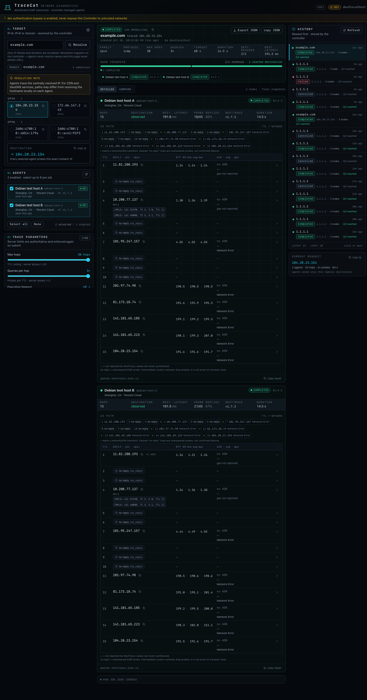

Side-by-side comparison view (aligned TTL rows, ASN transitions, honest
`no reply` and destination-latency deltas):

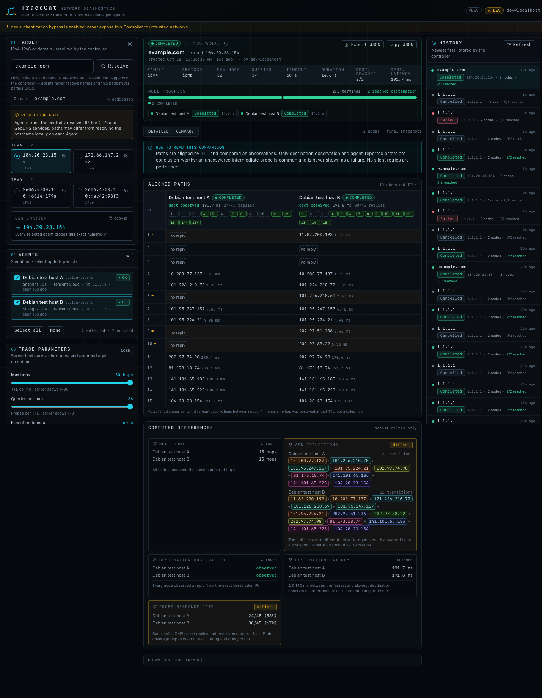

Initial dashboard (both Agents healthy) and the explicit address-selection
step:

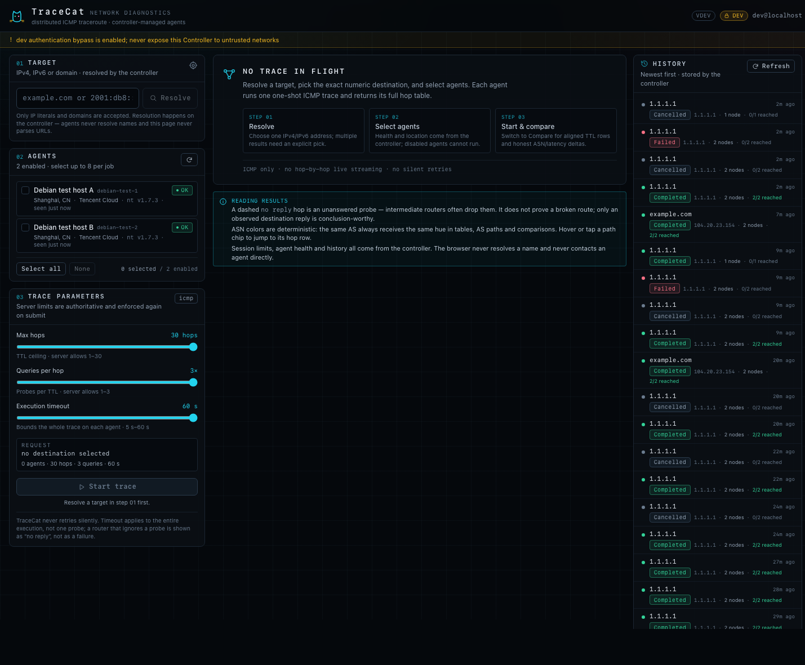

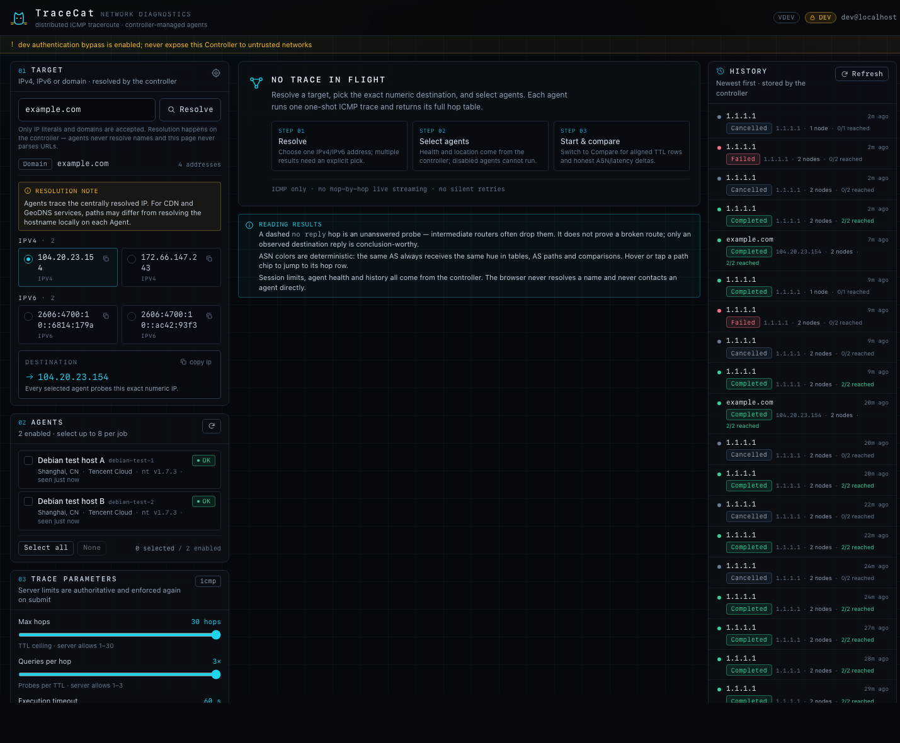

390 px mobile viewport (no horizontal overflow):

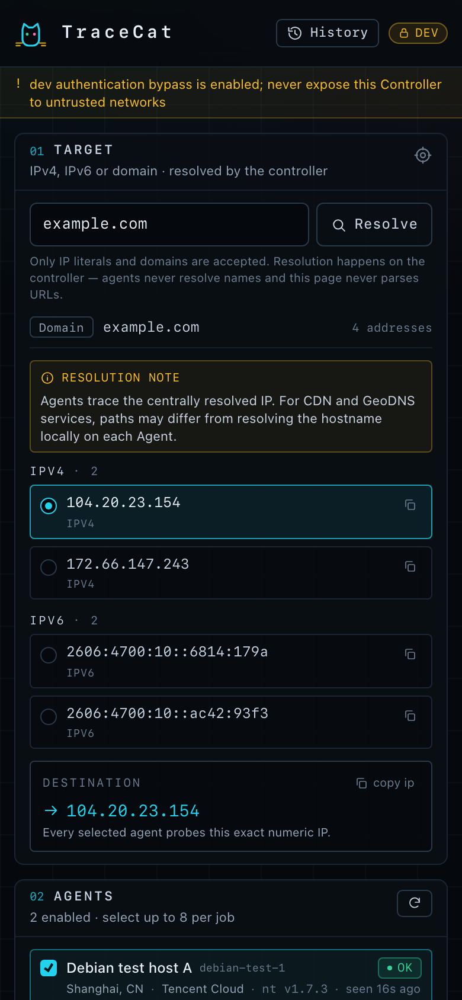

Machine-readable browser report: `verify/screenshots/browser-report.json`.

### 12.6 Phase-2 findings and non-blocking observations

No blocking defect was found in Phase 2. The following observations are minor
and documented rather than worked around:

1. **Dev-mode CSRF tokens rotate on Controller restart.** With
   `auth.mode=dev` and no `auth.cloudflare.csrf_secret_env`, the stateless CSRF
   key is random per process, so an already-open dashboard tab receives
   `403 csrf_failed` after a restart until it reloads the session. Production
   modes are unaffected (`local` sessions carry a persisted CSRF token;
   `cloudflare` can pin the key via `csrf_secret_env`). Worth a documentation
   sentence for dev-mode users.
2. **Fixed in `28f38f4`:** Controller `429` responses did not set
   `Retry-After` (the Agent did). `internal/controller/httputil.go` now sends
   `Retry-After: 1`; re-verified for login, resolve and job limits.
3. **Fixed in `28f38f4`:** `POST /api/v1/auth/login` did not reject a non-JSON
   `Content-Type` with `415` (the body was already strictly decoded/bounded and
   the password validated, so there was no bypass).
   `internal/controller/api.go` now returns `415 invalid_request`; re-verified
   with `text/plain`.
4. **`GET /assets/` returns the SPA index (200), not 404.** This is the
   documented "SPA fallback for extension-less GET paths" and never a directory
   listing; traversal attempts (`/assets/../../etc/passwd`, encoded variants)
   disclose nothing.
5. The harness deliberately restarts services many times; several rapid starts
   can trip systemd's default start limiter (`5 starts / 10 s`). The harness now
   clears `failed` state before restarting. This is a test artefact, but
   operators should remember that `Restart=on-failure` + `RestartSec=5s` means a
   crash-looping process eventually backs off (systemd default policy).
6. The Controller and both Agents were built with the ad-hoc `go build`
   command above, so they report `version="dev"`; release builds should inject
   version metadata via `-ldflags`. Cosmetic for verification.

### 12.7 Residual risks

- **Cloudflare Access mode was not deployed** (no Cloudflare account/tunnel in
  the verification environment). Its JWT/JWKS/allowlist logic is covered by the
  repository unit tests only; the deployed verification used `dev` and `local`
  modes. Treat `cloudflare` mode as code-reviewed, not deployment-verified.
- **Tailnet ACLs are not applied**: the Controller and Agents share a tailnet,
  but the example ACL (`deploy/tailscale/acl.hujson.example`) requires
  Controller/Agent tags. The Agent bearer token is enforced, but operators must
  still apply ACLs so only the Controller can reach `:8443/:8444`.
- **Agent transport is cleartext HTTP inside WireGuard** (documented design).
  The Controllers listen only on loopback; the Agents only on the tailnet.
- **Local/dev auth are single-factor / bypass modes.** Dev mode is refused on
  non-loopback listeners and rejects forwarding headers, but it must never be
  exposed; local mode is a single password (use Cloudflare Access with MFA for
  internet exposure).
- **Rate limits are in-memory** per Controller/Agent process and reset on
  restart (documented); they are not a billing/quota boundary.
- **SSE requires a proxy that supports streaming** (`X-Accel-Buffering: no` is
  sent); nginx/cloudflared work, buffering proxies will delay snapshots.
- **Session cookie `Secure`** was not exercised end-to-end because the tunnel
  uses an `http` origin; the code path is covered by unit tests. A production
  HTTPS `public_origin` sets `Secure` as documented.
- **NextTrace is external GPL-3.0 software** and remains a trust dependency;
  upgrade it deliberately and re-run `verify/agent-remote-verify.sh`.

### 12.8 Reproducing Phase 2

```bash
# 1. deploy controller + second agent + local-auth instance (from the checkout)
SKIP_BUILD=1 verify/setup-testhost-fullstack.sh

# 2. host-side suites (as root on the test host)
scp verify/controller-remote-verify.sh verify/controller-localauth-verify.sh \
    verify/agent-remote-verify.sh verify/check_trace_response.py root@HOST:/root/tc-verify/
ssh root@HOST 'bash /root/tc-verify/agent-remote-verify.sh'
ssh root@HOST 'bash /root/tc-verify/controller-remote-verify.sh'
ssh root@HOST 'bash /root/tc-verify/controller-localauth-verify.sh'

# 3. browser proof (from the Mac)
ssh -N -L 18090:127.0.0.1:8080 root@HOST &
"/Applications/Google Chrome.app/Contents/MacOS/Google Chrome" --headless=new \
  --remote-debugging-port=9333 --user-data-dir=/tmp/tc-verify-chrome \
  --no-first-run --no-default-browser-check --disable-gpu --no-proxy-server about:blank &
CDP_PORT=9333 APP_URL=http://127.0.0.1:18090/ OUT_DIR=verify/screenshots \
  node verify/e2e/drive.mjs
```

Expected: `SUMMARY: 126 PASS, 0 FAIL, 1 SKIP` (agent),
`SUMMARY: 125 PASS, 0 FAIL, 0 SKIP` (controller),
`SUMMARY: 61 PASS, 0 FAIL, 1 SKIP` (local auth),
`SUMMARY 17/17 browser checks passed`.

Note: the repository HEAD at report time (`feb0f1a`) adds only `README.md`
documentation on top of the delta commit, so the binaries and screenshots above
were built and captured from exactly the compiled production code at `28f38f4`.

### 12.9 Delta re-verification at `28f38f4`

Two small Controller changes were made from the verifier's observations; the
delta was rebuilt, redeployed and re-tested:

| Item | Detail |
| --- | --- |
| Commit | `28f38f4b99558814ce604ae4f596a6f90e6dc738` (`28f38f4`), parent `4e3aa59` |
| Changed production code | `internal/controller/httputil.go` — `Retry-After: 1` on every `429`; `internal/controller/api.go` — `POST /api/v1/auth/login` requires `Content-Type: application/json` (`415` otherwise). Agent/NextTrace code untouched. |
| Rebuilt / redeployed | both linux/amd64 binaries rebuilt at `28f38f4`; dev Controller, local-auth Controller and both Agents restarted; `/healthz` 200 on both Controllers, Agents active on `:8443`/`:8444` |
| Controller suite (re-run) | **125 PASS / 0 FAIL** — unchanged behavior (health, dev session/proxy guard, nodes, DNS, allowlist, multi-node job, SSE, export, history, cancellation, crash reconciliation, static/CSP/bundle) |
| Local-auth suite (re-run, +4 delta checks) | **61 PASS / 0 FAIL / 1 SKIP** — includes explicit `login text/plain → 415` and `Retry-After` on resolve/job/login `429`s |
| Browser smoke (re-run) | **17/17 checks** — dashboard loaded, one real two-node job completed, Compare + mobile view; 0 console errors / 0 uncaught exceptions / 0 CSP violations; screenshots refreshed at `28f38f4` |
| Agent matrix | **not re-run by design**: Agent code unchanged (diff for Agent/NextTrace/unit is empty); Phase-1 results above remain valid |
| Delta-specific results | `PASS login_text_plain_415` (415 invalid_request); `PASS resolve_429_retry_after` (1); `PASS job_429_retry_after` (1); `PASS login_429_retry_after` (1) |
| Totals after delta | grand total **329 PASS / 0 FAIL / 2 SKIP** (Agent 126; Controller 125; local auth 61; browser 17) |

The services are left running on the test host (`tracecat-agent`,
`tracecat-agent-b`, `tracecat-controller`, `tracecat-controller-local`) for
follow-up inspection. All secrets remain on the host; nothing in this
repository or this report contains a token or password.

## 13. v0.1.1 delta verification — TCP/UDP, interfaces, private bind, installer

### 13.1 Scope and verified SHA

Delta verification for the v0.1.1 feature batch on top of the v0.1.0 report
(§§0–12 above are historical and unchanged):

| Item | Value |
| --- | --- |
| Verified production code | Go/agent/controller sources are **unchanged since `bc98212`** (`git diff bc98212..<installer-fix HEAD> -- '*.go' internal cmd` is empty); the only code touched afterwards was `deploy/install.sh`, `deploy/install_test.sh`, `scripts/build-release.sh`, CI workflows and docs |
| Verified installer / packaging SHA | `2d27ee3751a1f3dc20e887961543630ae24f3262` (`2d27ee3`) — includes the three installer fixes below |
| Delta commits reviewed | `2a1aef1`…`bc98212` (contracts, TCP/UDP, interfaces, controller dispatch, dashboard, install.sh, CI release, release packaging) and `a3e02a1`, `8385e46`, `ff254fd`, `2d27ee3` (installer fixes) |
| Binaries rebuilt at final SHA | agent `sha256 5c09b8034d003f0c…`, controller `sha256 e0b7f73d3f9cb286…` (built by `scripts/build-release.sh 0.1.1 amd64` and by `verify/setup-testhost-*.sh`); Go code identical to `bc98212` where the agent/controller suites below were run |
| Host | Debian 13, systemd 257, Tailscale 1.104.4, NextTrace v1.7.3 on `100.81.98.125` |
| Release artifacts | local `dist/tracecat-{agent,controller}-linux-amd64.tar.gz` + `checksums.txt` (VERSION=0.1.1, layout `bin/`, `install.sh`, `deploy/systemd/`); offline `--tarball/--checksums` installer path fully tested here — see §13.10 for the post-tag release-asset smoke |
| Totals for this delta | **408 PASS / 0 FAIL / 3 SKIP** (Agent 174, Controller 155, installer 61, browser 18) |

### 13.2 New behaviour verified

| Feature | Evidence |
| --- | --- |
| Agent config schema | `security.allow_public_bind` + top-level `interfaces.{exclude,include}`; old `require_tailscale_bind`/`allow_non_tailscale_bind` removed and rejected as unknown fields; unit no longer hard-requires `tailscaled` |
| TCP/UDP probes | real traces to `1.1.1.1` via both Agents: TCP/443 and UDP/33494 completed; response echoes `protocol` and `port`; ICMP stays port-free; live child argv exactly `-4 -T ... -p 443 <target>`, `-4 -U ... -p 33494 <target>` (fixed positions, target last) |
| Port contract | missing port, 0, 65536, negative, JSON string, and port-on-icmp all `400 invalid_request` with no child process; agent-level and controller-level |
| Protocol allowlists | Agent instance with `allowed_protocols=[icmp]` advertises `limits.protocols=[icmp]` and rejects TCP/UDP `400` before exec; temporary Controller with `limits.allowed_protocols=[icmp]` rejects TCP at dispatch (`400`, no child) and accepts ICMP |
| Interface selection | `/v1/health` advertises sorted `["eth0","tailscale0"]` (loopback/docker/veth/bridge excluded); Controller `/nodes` exposes the list; a job with `node_interfaces:{"debian-test-1":"eth0"}` dispatches `-D eth0` for that node only, echoes `interface=eth0` on that node and automatic routing on the other (argv `-D eth0` present for exactly one child); invalid/loopback/not-advertised/traversal names `400` before exec at both layers |
| Generic private bind policy | accepted: loopback, RFC1918, CGNAT/Tailscale, ULA (binds + health 200); rejected: wildcard v4/v6, empty host, hostname, multicast, unassigned, and a globally routable address unless `security.allow_public_bind=true` (which binds and logs a warning); missing/short token still fails closed |
| Installer / release packaging | shipped `deploy/install_test.sh` passes on Debian bash 5.2; fresh Agent install from tarball (`--no-start` honoured, generated strict config, 0600 token, binds + auth, health protocols/interfaces); Controller installs in dev and local modes; checksum mismatch and wrong-contents tarballs refused without replacing the binary; upgrade keeps existing config/env byte-identical and advances the binary; missing Agent token env writes commented placeholders, does not start the service and leaves no listener |
| Browser UI | protocol selector (ICMP/TCP/UDP), TCP port input, per-node interface dropdowns, `tcp/443` job with `iface eth0` / `iface auto` chips and 60 hop rows across both nodes, UDP/33494 run, 390px mobile layout; 0 console errors / 0 uncaught exceptions / 0 CSP violations |

### 13.3 Defects found during this delta (all fixed and re-verified)

All three were in `deploy/install.sh` (new in v0.1.1) and blocked the
one-command installer; the shipped suite is green at `2d27ee3`.

| # | Severity | Symptom | Root cause | Fix | Re-verified |
| --- | --- | --- | --- | --- | --- |
| D4 | P1 | Controller install with any `--agent` failed: `invalid agent url` | non-portable ERE bracket class `[A-Za-z0-9._:\-\[\]/]` never matches on bash 3.2/5.2 | `8385e46`: portable `[][A-Za-z0-9._:/-]` class + `deploy/install_test.sh` in CI | Yes — shipped `install_test.sh` PASS, live install passes |
| D5 | P1 | Controller install with any `--public-origin` failed: `invalid --public-origin` | same escaped-bracket class on the public-origin check | `ff254fd`: portable class + public-origin matrix in `install_test.sh` | Yes — class matrix + live install start |
| D6 | P1 | Successful dev/local Controller install exited 1 | trailing `[[ "$AUTH_MODE" == "cloudflare" ]] && log …` as last command of the success branch under `set -e` | `2d27ee3`: if-block, explicit `return 0`, root-free `--help`, exit-status tests | Yes — installer suite now 61/61 PASS |

Minimal reproductions used (kept for the record):

```bash
# D4 (pre-8385e46)
bash deploy/install.sh controller --auth dev --listen 127.0.0.1:8080 \
  --public-origin http://127.0.0.1:18090 \
  --agent node-1,http://10.0.0.5:8443,TRACECAT_AGENT_TOKEN
# -> [tracecat] ERROR: invalid agent url: http://10.0.0.5:8443

# D5 (pre-ff254fd) — after D4 fix, same command got further:
# -> [tracecat] ERROR: invalid --public-origin

# D6 (pre-2d27ee3) — install succeeded and the service was healthy, but:
# -> [tracecat] tracecat-controller enabled and started ... exit status 1
[[ "http://10.0.0.5:8443" =~ ^https?://[A-Za-z0-9._:\-\[\]/]+/?$ ]]; echo $?   # 1 (never matches)
```

### 13.4 Results

Agent suite (`verify/agent-remote-verify.sh`, extended for the new schema,
protocols/ports, interfaces and the bind matrix) — **174 PASS / 0 FAIL / 2 SKIP**:

#### A. deployment posture

| # | Check | Expected | Observed | Result |
|---|---|---|---|---|
| A1 | `unit_enabled` | enabled | `enabled` | PASS |
| A2 | `unit_active` | active | `active` | PASS |
| A3 | `runs_as_unprivileged` | User=tracecat | `tracecat` | PASS |
| A4 | `no_new_privileges` | yes | `yes` | PASS |
| A5 | `ambient_cap_net_raw` | cap_net_raw | `cap_net_raw` | PASS |
| A6 | `capability_bounding_set` | cap_net_raw | `cap_net_raw` | PASS |
| A7 | `protect_system` | strict | `strict` | PASS |
| A8 | `private_tmp` | yes | `yes` | PASS |
| A9 | `memory_deny_write_execute` | disabled (nexttrace needs W+X or it SIGSEGVs) | `no` | PASS |
| A10 | `binds_only_tailscale_ip` | single 100.81.98.125:8443 | `100.81.98.125:8443` | PASS |
| A11 | `no_wildcard_bind` | no 0.0.0.0/:: listener | `100.81.98.125:8443` | PASS |
| A12 | `not_reachable_on_public_ip` | no HTTP 200 on public IP | `code=000` | PASS |
| A13 | `config_permissions` | 640 root:tracecat | `640 root:tracecat` | PASS |
| A14 | `secret_file_permissions` | 600 root:root | `600 root:root` | PASS |
| A15 | `token_entropy_length` | >=32 bytes | `len=64` | PASS |
| A16 | `agent_process_user` | tracecat | `tracecat` | PASS |

#### B. authentication

| # | Check | Expected | Observed | Result |
|---|---|---|---|---|
| B1 | `auth_missing_token` | 401 | `401 unauthorized` | PASS |
| B2 | `auth_challenge_header` | WWW-Authenticate: Bearer | `Bearer` | PASS |
| B3 | `auth_wrong_token` | 401 | `401 unauthorized` | PASS |
| B4 | `auth_wrong_scheme` | 401 | `401 unauthorized` | PASS |
| B5 | `auth_empty_bearer` | 401 | `401 unauthorized` | PASS |
| B6 | `auth_before_routing` | 401 on unknown path without token | `401` | PASS |
| B7 | `health_with_token` | 200 | `200` | PASS |
| B8 | `health_schema` | tracecat.agent.v1 | `tracecat.agent.v1` | PASS |
| B9 | `health_status_ok` | ok (nexttrace usable) | `ok nexttrace.available=True err=` | PASS |
| B10 | `health_node_id` | debian-test-1 | `debian-test-1` | PASS |
| B11 | `health_limits` | max_timeout_ms=60000 max_concurrent=4 | `60000/4` | PASS |
| B12 | `health_time_format` | RFC3339Nano | `ok` | PASS |
| B13 | `health_limits_protocols` | protocols=[icmp tcp udp] | `['icmp', 'tcp', 'udp']` | PASS |
| B14 | `health_capabilities_extended` | detected tcp/udp/port/device | `device,ipv4,ipv6,json,max_hops,port,queries,tcp,timeout,udp` | PASS |
| B15 | `health_interfaces_eligible` | sorted, excludes lo/docker/veth/bridge, includes eth0 | `ok ['eth0', 'tailscale0']` | PASS |
| B16 | `health_no_secret_or_path_leak` | no token/path/env | `none` | PASS |
| B17 | `security_headers` | application/json + nosniff + no-store | `Cache-Control: no-store;Content-Type: application/json;X-Content-Type-Options: nosniff` | PASS |

#### C. HTTP method handling

| # | Check | Expected | Observed | Result |
|---|---|---|---|---|
| C1 | `trace_get_method` | 405 | `405 Allow=POST` | PASS |
| C2 | `health_post_method` | 405 | `405 Allow=GET` | PASS |
| C3 | `trace_put_method` | 405 | `405 Allow=POST` | PASS |
| C4 | `unauth_unaffected_by_method_check` | 401 first | `401` | PASS |

#### D. strict JSON / schema / limits

| # | Check | Expected | Observed | Result |
|---|---|---|---|---|
| D1 | `valid_request_reaches_trace` | 200 (terminal status inside) | `200 status=completed err=` | PASS |
| D2 | `json_unknown_field` | 400 invalid_request | `400 invalid_request` | PASS |
| D3 | `json_trailing_data` | 400 invalid_request | `400 invalid_request` | PASS |
| D4 | `wrong_schema_version` | 400 unsupported_schema_version | `400 unsupported_schema_version` | PASS |
| D5 | `bad_job_id` | 400 | `400 invalid_request` | PASS |
| D6 | `wrong_node_id` | 403 forbidden | `403 forbidden` | PASS |
| D7 | `bad_family` | 400 | `400 invalid_request` | PASS |
| D8 | `bad_protocol` | 400 (tcp not in MVP) | `400 invalid_request` | PASS |
| D9 | `max_hops_zero` | 400 | `400 invalid_request` | PASS |
| D10 | `max_hops_above_global_max` | 400 | `400 invalid_request` | PASS |
| D11 | `queries_zero` | 400 | `400 invalid_request` | PASS |
| D12 | `queries_above_global_max` | 400 | `400 invalid_request` | PASS |
| D13 | `timeout_below_min` | 400 | `400 invalid_request` | PASS |
| D14 | `timeout_above_agent_max` | 400 (agent max 60000) | `400 invalid_request` | PASS |
| D15 | `family_target_mismatch` | 400 | `400 invalid_request` | PASS |

#### E. target rejection (injection / SSRF policy)

| # | Check | Expected | Observed | Result |
|---|---|---|---|---|
| E1 | `inject_reject[hostname]` | 4xx target_rejected/invalid_request | `422 target_rejected` | PASS |
| E2 | `inject_reject[semicolon_cmd]` | 4xx target_rejected/invalid_request | `422 target_rejected` | PASS |
| E3 | `inject_reject[dollar_paren]` | 4xx target_rejected/invalid_request | `422 target_rejected` | PASS |
| E4 | `inject_reject[backticks]` | 4xx target_rejected/invalid_request | `422 target_rejected` | PASS |
| E5 | `inject_reject[flag_help]` | 4xx target_rejected/invalid_request | `422 target_rejected` | PASS |
| E6 | `inject_reject[flag_family]` | 4xx target_rejected/invalid_request | `422 target_rejected` | PASS |
| E7 | `inject_reject[flag_output]` | 4xx target_rejected/invalid_request | `422 target_rejected` | PASS |
| E8 | `inject_reject[bracketed_v6]` | 4xx target_rejected/invalid_request | `422 target_rejected` | PASS |
| E9 | `inject_reject[zoned_v6]` | 4xx target_rejected/invalid_request | `422 target_rejected` | PASS |
| E10 | `inject_reject[mapped_v6]` | 4xx target_rejected/invalid_request | `400 invalid_request` | PASS |
| E11 | `inject_reject[private_10]` | 4xx target_rejected/invalid_request | `422 target_rejected` | PASS |
| E12 | `inject_reject[private_172]` | 4xx target_rejected/invalid_request | `422 target_rejected` | PASS |
| E13 | `inject_reject[private_192]` | 4xx target_rejected/invalid_request | `422 target_rejected` | PASS |
| E14 | `inject_reject[metadata_linklocal]` | 4xx target_rejected/invalid_request | `422 target_rejected` | PASS |
| E15 | `inject_reject[documentation_203]` | 4xx target_rejected/invalid_request | `422 target_rejected` | PASS |
| E16 | `inject_reject[documentation_198]` | 4xx target_rejected/invalid_request | `422 target_rejected` | PASS |
| E17 | `inject_reject[cgnat_100_64]` | 4xx target_rejected/invalid_request | `422 target_rejected` | PASS |
| E18 | `inject_reject[unspecified]` | 4xx target_rejected/invalid_request | `422 target_rejected` | PASS |
| E19 | `inject_reject[multicast]` | 4xx target_rejected/invalid_request | `422 target_rejected` | PASS |
| E20 | `inject_reject[loopback_v6]` | 4xx target_rejected/invalid_request | `422 target_rejected` | PASS |
| E21 | `inject_reject[documentation_v6]` | 4xx target_rejected/invalid_request | `422 target_rejected` | PASS |
| E22 | `inject_reject[with_port]` | 4xx target_rejected/invalid_request | `422 target_rejected` | PASS |
| E23 | `inject_reject[url]` | 4xx target_rejected/invalid_request | `422 target_rejected` | PASS |
| E24 | `inject_reject[trailing_space]` | 4xx target_rejected/invalid_request | `422 target_rejected` | PASS |
| E25 | `inject_reject[newline]` | 4xx target_rejected/invalid_request | `400 invalid_request` | PASS |
| E26 | `no_injection_side_effect` | /tmp/tracecat-pwned absent | `absent` | PASS |
| E27 | `no_child_ran_for_rejected_targets` | no nexttrace process | `none` | PASS |
| E28 | `allowed_target_still_reaches_runner` | 200 | `200 status=completed` | PASS |

#### F. content type and body size

| # | Check | Expected | Observed | Result |
|---|---|---|---|---|
| F1 | `content_type_text_plain` | 415 | `415 invalid_request` | PASS |
| F2 | `content_type_missing` | 415 | `415 invalid_request` | PASS |
| F3 | `content_type_with_charset` | 200 | `200 status=completed` | PASS |
| F4 | `body_over_64kib` | 413 payload_too_large | `413 payload_too_large size=71904` | PASS |
| F5 | `empty_body` | 400 | `400 invalid_request` | PASS |

#### G. rate limiting

| # | Check | Expected | Observed | Result |
|---|---|---|---|---|
| G1 | `burst_rate_limit` | >=1x 429 among 16 rapid requests | `codes=200 200 200 200 200 200 200 200 200 429 429 429 429 429 429 429` | PASS |
| G2 | `rate_limit_envelope` | 429 rate_limited | `429 rate_limited retry_after=1` | PASS |
| G3 | `rate_limit_retry_after` | numeric seconds | `1` | PASS |

#### H. platform caveat: ICMP reachability from this vantage point

| # | Check | Expected | Observed | Result |
|---|---|---|---|---|
| H1 | `icmp_ttl_exceeded_available` | informational | `ping -t 1: 1 packets transmitted, 0 received, 100% packet loss, time 0ms` | SKIP (informational) |

#### I. real traces and capability proof

| # | Check | Expected | Observed | Result |
|---|---|---|---|---|
| I1 | `real_trace_ipv4_http` | 200 | `200` | PASS |
| I2 | `real_trace_ipv4_contract` | all wire checks pass | `SUMMARY 46/46 checks passed` | PASS |
| I3 | `real_trace_ipv4_detail` | >=20 sub-checks | `SUMMARY 46/46 checks passed` | PASS |
| I4 | `real_trace_ipv6_http` | 200 | `200 status=completed` | PASS |
| I5 | `real_trace_ipv6_contract` | all wire checks pass | `SUMMARY 45/45 checks passed` | PASS |
| I6 | `cap_net_raw_effective` | CAP_NET_RAW set, uid tracecat | `uid=tracecat CapEff=0000000000002000 CapAmb=0000000000002000 net_raw=yes` | PASS |
| I7 | `child_env_minimal` | no token/config/env leak | `leak=none keys=HOME,LANG,LC_ALL,NO_COLOR,PATH` | PASS |
| I8 | `raw_socket_child_running` | nexttrace alive (no permission abort) | `pid=3637178` | PASS |
| I9 | `cancellation_kills_process_group` | no nexttrace within 12s of client disconnect | `reaped` | PASS |
| I10 | `cancellation_logged` | journal status=cancelled | `status=cancelled` | PASS |
| I11 | `agent_survives_cancel` | active | `active` | PASS |
| I12 | `concurrency_503` | 503 busy when 4 traces in flight | `503 busy children=4` | PASS |
| I13 | `agent_recovers_after_load` | 200 health | `200` | PASS |

#### P. probe protocols, ports and interfaces

| # | Check | Expected | Observed | Result |
|---|---|---|---|---|
| P1 | `protocol_section_precondition` | agent ok | `ok` | PASS |
| P2 | `icmp_regression_http` | 200 | `200` | PASS |
| P3 | `icmp_argv_exact` | no -T/-U/-p/-D | `SUMMARY 20/20 argv checks passed` | PASS |
| P4 | `icmp_contract_regression` | wire contract | `SUMMARY 45/45 checks passed` | PASS |
| P5 | `real_tcp_trace_http` | 200 | `200` | PASS |
| P6 | `tcp_argv_exact` | -4 -T ... -p 443 target | `SUMMARY 20/20 argv checks passed` | PASS |
| P7 | `tcp_contract` | completed, port echoed, no ansiterm | `SUMMARY 45/45 checks passed` | PASS |
| P8 | `tcp_completed` | completed | `completed hops= 8` | PASS |
| P9 | `real_udp_trace_http` | 200 | `200` | PASS |
| P10 | `udp_argv_exact` | -4 -U ... -p 33494 target | `SUMMARY 20/20 argv checks passed` | PASS |
| P11 | `udp_contract` | completed, port echoed | `SUMMARY 45/45 checks passed` | PASS |
| P12 | `real_icmp_interface_http` | 200 | `200` | PASS |
| P13 | `interface_argv_exact` | -4 -D eth0 ... target | `SUMMARY 20/20 argv checks passed` | PASS |
| P14 | `interface_contract` | interface echoed | `SUMMARY 45/45 checks passed` | PASS |
| P15 | `real_tcp_interface_http` | 200 | `200` | PASS |
| P16 | `tcp_interface_argv_exact` | -4 -T -D tailscale0 ... -p 443 target | `SUMMARY 20/20 argv checks passed` | PASS |
| P17 | `tcp_interface_contract` | interface+port echoed | `SUMMARY 45/45 checks passed` | PASS |
| P18 | `trace_reject[tcp_missing_port]` | 400 invalid_request, no child | `400 invalid_request children=0` | PASS |
| P19 | `trace_reject[tcp_port_zero]` | 400 invalid_request, no child | `400 invalid_request children=0` | PASS |
| P20 | `trace_reject[tcp_port_too_high]` | 400 invalid_request, no child | `400 invalid_request children=0` | PASS |
| P21 | `trace_reject[tcp_port_string]` | 400 invalid_request, no child | `400 invalid_request children=0` | PASS |
| P22 | `trace_reject[tcp_port_negative]` | 400 invalid_request, no child | `400 invalid_request children=0` | PASS |
| P23 | `trace_reject[udp_missing_port]` | 400 invalid_request, no child | `400 invalid_request children=0` | PASS |
| P24 | `trace_reject[icmp_with_port]` | 400 invalid_request, no child | `400 invalid_request children=0` | PASS |
| P25 | `trace_reject[invalid_protocol_sctp]` | 400 invalid_request, no child | `400 invalid_request children=0` | PASS |
| P26 | `trace_reject[invalid_protocol_case]` | 400 invalid_request, no child | `400 invalid_request children=0` | PASS |
| P27 | `interface_reject[loopback]` | 400 invalid_request, no child | `400 invalid_request iface=lo children=0` | PASS |
| P28 | `interface_reject[container]` | 400 invalid_request, no child | `400 invalid_request iface=docker0 children=0` | PASS |
| P29 | `interface_reject[missing]` | 400 invalid_request, no child | `400 invalid_request iface=eth9 children=0` | PASS |
| P30 | `interface_reject[invalid_chars]` | 400 invalid_request, no child | `400 invalid_request iface=bad iface! children=0` | PASS |
| P31 | `interface_reject[too_long]` | 400 invalid_request, no child | `400 invalid_request iface=abcdefghijklmnop children=0` | PASS |
| P32 | `interface_reject[path_traversal]` | 400 invalid_request, no child | `400 invalid_request iface=../../etc/passwd children=0` | PASS |
| P33 | `icmp_only_agent_started` | temporary loopback agent with allowed_protocols=[icmp] | `up=1` | PASS |
| P34 | `agent_protocol_allowlist_health` | limits.protocols=[icmp] | `icmp` | PASS |
| P35 | `agent_protocol_allowlist[tcp]` | 400, no child executed | `400 invalid_request children=0` | PASS |
| P36 | `agent_protocol_allowlist[udp]` | 400, no child executed | `400 invalid_request children=0` | PASS |
| P37 | `agent_protocol_allowlist[icmp_allowed]` | 200 (execution outcome reported in status) | `200 failed nexttrace_failed` | PASS |
| P38 | `no_stray_temp_listeners` | none | `none` | PASS |

#### J. bind policy matrix (generic private networking)

| # | Check | Expected | Observed | Result |
|---|---|---|---|---|
| J1 | `bind_matrix_environment` | informational | `priv_v4=10.0.0.12 ula_v6=fd7a:115c:a1e0::4d2f:627e public_v6=2402:4e00:c032:3d00:26f6:499a:101c:0` | SKIP (informational) |
| J2 | `unit_no_tailscaled_hard_dependency` | no Requires=tailscaled (any private overlay works) | `sysinit.target system.slice` | PASS |
| J3 | `agent_config_new_schema` | allow_public_bind + interfaces, no tailscale flags | `new schema: allow_public_bind=false, interfaces present, no tailscale keys` | PASS |
| J4 | `bind_accept[loopback]` | binds and serves health | `healthz=200 listen=127.0.0.1:9461 allow_public=false` | PASS |
| J5 | `bind_accept[rfc1918]` | binds and serves health | `healthz=200 listen=10.0.0.12:9462 allow_public=false` | PASS |
| J6 | `bind_accept[cgnat]` | binds and serves health | `healthz=200 listen=100.81.98.125:9463 allow_public=false` | PASS |
| J7 | `bind_accept[ula_v6]` | binds and serves health | `healthz=200 listen=[fd7a:115c:a1e0::4d2f:627e]:9464 allow_public=false` | PASS |
| J8 | `bind_refuse[wildcard_v4]` | refused: wildcard binds are refused | `rc=exited error="listen: wildcard binds are refused; configure an explicit local address"` | PASS |
| J9 | `bind_refuse[wildcard_v6]` | refused: wildcard binds are refused | `rc=exited error="listen: wildcard binds are refused; configure an explicit local address"` | PASS |
| J10 | `bind_refuse[empty_host]` | refused: wildcard binds are refused | `rc=exited error="listen: wildcard binds are refused; configure an explicit local address"` | PASS |
| J11 | `bind_refuse[hostname]` | refused: numeric IP address | `rc=exited error="listen: listen host must be a numeric IP address (hostnames are not accepted)"` | PASS |
| J12 | `bind_refuse[multicast]` | refused: multicast | `rc=exited error="listen: multicast listen addresses are not accepted"` | PASS |
| J13 | `bind_refuse[unassigned]` | refused: is not assigned | `rc=exited error="listen address 10.0.0.99 is not assigned to any local interface"` | PASS |
| J14 | `bind_refuse[public_refused]` | refused: globally routable | `rc=exited error="listen address 2402:4e00:c032:3d00:26f6:499a:101c:0 is globally routable; set security.allow_public_bind=true to bind a public address"` | PASS |
| J15 | `bind_accept[public_allowed]` | binds and serves health | `healthz=200 listen=[2402:4e00:c032:3d00:26f6:499a:101c:0]:9472 allow_public=true` | PASS |
| J16 | `public_bind_logs_warning` | warning when binding a public address | `level=WARN msg="listening on a publicly routable address because security.allow_public_bind=true"` | PASS |
| J17 | `bind_refuse[missing_token]` | startup fails without the token env | `rc=1 error="auth.token_env \"` | PASS |
| J18 | `bind_refuse[short_token]` | startup fails with a short token | `rc=1 error="auth.token_env \"` | PASS |
| J19 | `no_stray_listener_from_bind_tests` | only the main service listener on 8443 | `100.81.98.125:8443` | PASS |

#### K. restart resilience and journal hygiene

| # | Check | Expected | Observed | Result |
|---|---|---|---|---|
| K1 | `restart_active` | active | `active` | PASS |
| K2 | `restart_bind_unchanged` | 100.81.98.125:8443 | `100.81.98.125:8443` | PASS |
| K3 | `restart_auth_and_health` | 200 with token | `200` | PASS |
| K4 | `restart_still_requires_token` | 401 without token | `401` | PASS |
| K5 | `journal_no_secret_or_path_leak` | no token/config path/binary path | `none` | PASS |
| K6 | `journal_clean_no_warn_error` | no WARN/ERROR lines | `` | PASS |

#### L. graceful shutdown reaps in-flight traces

| # | Check | Expected | Observed | Result |
|---|---|---|---|---|
| L1 | `child_running_before_shutdown` | >=1 nexttrace child | `children=1` | PASS |
| L2 | `shutdown_reaps_children` | service stopped, no orphan nexttrace | `stopped=1 orphans=none` | PASS |
| L3 | `shutdown_logged` | journal 'shutdown requested; cancelling in-flight traces' | `shutdown requested; cancelling in-flight traces` | PASS |
| L4 | `healthy_after_shutdown_cycle` | 200 | `200` | PASS |

#### M. transport hardening (slowloris / header size / auth edges)

| # | Check | Expected | Observed | Result |
|---|---|---|---|---|
| M1 | `read_header_timeout_5s` | connection closed by server ~5s on incomplete headers | `closed_after=5.0s bytes=0` | PASS |
| M2 | `max_header_bytes` | 431 for ~40KiB header | `code=431` | PASS |
| M3 | `auth_token_prefix_rejected` | 401 | `401` | PASS |
| M4 | `auth_scheme_case_insensitive` | 200 (RFC 7235 scheme is case-insensitive) | `200` | PASS |
| M5 | `unknown_path_with_token` | 404 not_found | `404 not_found` | PASS |
| M6 | `head_not_allowed` | 405 | `code=405` | PASS |
| M7 | `left_running_for_phase2` | active | `active` | PASS |


Controller suite (`verify/controller-remote-verify.sh`, extended with TCP/UDP,
per-node interface dispatch, controller protocol allowlist and the controller
port/interface rejection matrix) — **155 PASS / 0 FAIL / 0 SKIP**:

#### A. deployment posture

| # | Check | Expected | Observed | Result |
|---|---|---|---|---|
| A1 | `unit_enabled` | enabled | `enabled` | PASS |
| A2 | `unit_active` | active | `active` | PASS |
| A3 | `runs_as_unprivileged` | tracecat | `tracecat` | PASS |
| A4 | `no_new_privileges` | yes | `yes` | PASS |
| A5 | `protect_system` | strict | `strict` | PASS |
| A6 | `memory_deny_write_execute` | yes (Controller never execs nexttrace) | `yes` | PASS |
| A7 | `loopback_only_listener` | 127.0.0.1:8080 | `127.0.0.1:8080` | PASS |
| A8 | `no_wildcard_listener` | no 0.0.0.0/:: on 8080 | `127.0.0.1:8080` | PASS |
| A9 | `not_publicly_reachable` | no HTTP 200 | `code=000` | PASS |
| A10 | `config_permissions` | 640 root:tracecat | `640 root:tracecat` | PASS |
| A11 | `env_file_permissions` | 600 root:root | `600 root:root` | PASS |
| A12 | `database_permissions` | 0600 owner tracecat | `600 tracecat:tracecat` | PASS |
| A13 | `process_user` | tracecat | `tracecat` | PASS |

#### A2. target allowlist configuration (security.allowed_cidrs)

| # | Check | Expected | Observed | Result |
|---|---|---|---|---|
| A2.1 | `allowlist_rejects_default_route` | startup fails: 0.0.0.0/0 rejected | `rc=1 configuration error: config: security.allowed_cidrs: invalid target policy: "0.0.0.0/0" is` | PASS |
| A2.2 | `allowlist_rejects_invalid_cidr` | startup fails on malformed CIDR | `rc=1 configuration error: config: security.allowed_cidrs: invalid target policy: "not-a-cidr":` | PASS |
| A2.3 | `allowlist_instance_started` | temporary controller with 10.0.0.0/8 allowlist | `up=1` | PASS |
| A2.4 | `allowlist_allows_configured_cidr` | 10.0.0.1 resolves (200 kind=ip) | `code=200 kind=ip` | PASS |
| A2.5 | `default_policy_still_denies` | main instance 422 target_rejected | `422 target_rejected` | PASS |

#### B. health and session (dev auth mode)

| # | Check | Expected | Observed | Result |
|---|---|---|---|---|
| B1 | `healthz_ok` | 200 {status:ok} | `200 ok` | PASS |
| B2 | `healthz_minimal` | only status+schema_version | `schema_version,status` | PASS |
| B3 | `dev_session_authenticated` | 200 authenticated=true | `200 True mode=dev` | PASS |
| B4 | `session_csrf_token` | >=32 chars | `len=43` | PASS |
| B5 | `session_limits_match_config` | max_hops=30 max_queries=3 | `30/3/60000` | PASS |
| B6 | `session_limits_protocols` | protocols=[icmp tcp udp] | `icmp,tcp,udp` | PASS |
| B7 | `dev_mode_warning` | warning about dev bypass in session | `dev authentication bypass is enabled; never expose this Controller to untrusted networks` | PASS |
| B8 | `dev_rejects_xff` | 403 | `403 forbidden` | PASS |
| B9 | `dev_rejects_x_real_ip` | 403 | `403 forbidden` | PASS |
| B10 | `dev_rejects_xfh` | 403 | `403 forbidden` | PASS |
| B11 | `login_absent_in_dev` | 404 | `404 not_found` | PASS |
| B12 | `logout_absent_in_dev` | 404 | `404 not_found` | PASS |
| B13 | `identity_headers_ignored` | 200 dev (forged JWT ignored in dev mode) | `200 mode=dev` | PASS |
| B14 | `identity_email_header_not_trusted` | user stays dev@localhost | `200 user=dev@localhost` | PASS |

#### C. node registry

| # | Check | Expected | Observed | Result |
|---|---|---|---|---|
| C1 | `nodes_ok` | 200 | `200` | PASS |
| C2 | `nodes_count` | 2 | `2` | PASS |
| C3 | `agents_health_ok` | both agents ok with v1.7.3 | `debian-test-1=ok/v1.7.3,debian-test-2=ok/v1.7.3` | PASS |
| C4 | `nodes_no_url_or_secret_leak` | no agent URLs/tokens/paths | `none` | PASS |
| C5 | `nodes_expose_interfaces` | each node advertises sorted eligible interfaces incl. eth0 | `nodes=debian-test-1:eth0,tailscale0,debian-test-2:eth0,tailscale0` | PASS |

#### D. central DNS resolution

| # | Check | Expected | Observed | Result |
|---|---|---|---|---|
| D1 | `resolve_literal` | 200 kind=ip | `200 kind=ip n=1` | PASS |
| D2 | `literal_preselectable` | requires_selection=false | `False` | PASS |
| D3 | `resolve_domain` | 200 kind=domain | `200 kind=domain` | PASS |
| D4 | `domain_addresses_valid` | valid canonical A/AAAA entries | `4 addresses families=ipv4,ipv6 selection=True trunc=False warnings=1` | PASS |
| D5 | `domain_cdn_warning` | GeoDNS warning present | `Agents trace the centrally resolved IP. For CDN and GeoDNS services, paths may differ from resolving the hostname locally on each Agent.` | PASS |
| D6 | `resolution_selection_semantics` | requires_selection == (count>1) | `n=4 selection=True` | PASS |
| D7 | `resolve_multi_address_domain` | 200 with multiple choices | `200 1 addresses families=ipv4 selection=False` | PASS |
| D8 | `resolve_reject[not a domain"}]` | 400/422 | `400 invalid_request` | PASS |
| D9 | `resolve_reject[example.com;id"}]` | 400/422 | `400 invalid_request` | PASS |
| D10 | `resolve_reject[10.0.0.1"}]` | 400/422 | `422 target_rejected` | PASS |
| D11 | `resolve_reject[203.0.113.10"}]` | 400/422 | `422 target_rejected` | PASS |
| D12 | `resolve_reject[http://example.com/"}]` | 400/422 | `400 invalid_request` | PASS |
| D13 | `resolve_body_over_1kib` | 413 | `413 payload_too_large size=2015` | PASS |

#### E. multi-node job, SSE, history, export

| # | Check | Expected | Observed | Result |
|---|---|---|---|---|
| E1 | `resolve_ip_for_job` | 1.1.1.1 | `1.1.1.1` | PASS |
| E2 | `job_create_multi_node` | 202 | `202` | PASS |
| E3 | `job_id_shape` | 32 hex | `1567f7611f45b30a750dc5ded4ab3690` | PASS |
| E4 | `job_initial_status` | pending/running | `pending` | PASS |
| E5 | `sse_connect` | 200 | `200` | PASS |
| E6 | `sse_content_type` | text/event-stream | `text/event-stream` | PASS |
| E7 | `sse_event_job` | event: job snapshot(s) | `events=4` | PASS |
| E8 | `sse_snapshots_bare_json` | job snapshots, terminal close | `4 snapshots, terminal=completed, nodes=2` | PASS |
| E9 | `sse_closed_on_terminal` | server closed stream (curl exit 0, not timeout) | `curl_exit=0 code=200` | PASS |
| E10 | `job_completed` | completed | `completed` | PASS |
| E11 | `icmp_job_has_no_port_or_interface` | no port/interface keys on icmp | `icmp job: no port/interface keys, both nodes auto` | PASS |
| E12 | `both_nodes_completed_with_hops` | both completed, hops parsed | `debian-test-1=completed/hops=14 debian-test-2=completed/hops=14` | PASS |
| E13 | `job_node_summaries` | per-node summaries present | `debian-test-1: {'hop_count': 14, 'reached_destination': True, 'destination_rtt_ms': 250.242, 'replies': 5, 'probes': 14} \| debian-test-2: {'hop_count': 14, 'reached_destination': True, 'destination_rtt_ms': 237.56, 'replies': 6, 'probes': 14}` | PASS |
| E14 | `destination_ptr_reverse_dns` | 1.1.1.1 hop shows one.one.one.one | `reverse_dns=True records=['debian-test-1/1.1.1.1=one.one.one.one']` | PASS |
| E15 | `export_ok` | 200 | `200` | PASS |
| E16 | `export_content_disposition` | attachment filename | `attachment; filename="tracecat-1567f7611f45b30a750dc5ded4ab3690.json"` | PASS |
| E17 | `export_structure_bounded_raw` | 2 raw results, pure JSON, no banner | `raw_results=['debian-test-1', 'debian-test-2'] sizes={'debian-test-1': 3888, 'debian-test-2': 4290}` | PASS |
| E18 | `export_no_banner_text` | no NextTrace advisory | `none` | PASS |
| E19 | `history_list` | 200 | `200` | PASS |
| E20 | `history_persists_across_restart` | job retrievable after restart | `200 id=1567f7611f45b30a750dc5ded4ab3690` | PASS |
| E21 | `controller_restart_healthy` | active | `active` | PASS |

#### E2. TCP/UDP and per-node interface dispatch

| # | Check | Expected | Observed | Result |
|---|---|---|---|---|
| E2.1 | `job_create_tcp` | 202 | `202 tcp/443` | PASS |
| E2.2 | `tcp_job_completed` | completed | `completed` | PASS |
| E2.3 | `tcp_dispatched_to_both_nodes` | >=2 concurrent nexttrace children | `max_children=2` | PASS |
| E2.4 | `tcp_job_echo_and_contract` | protocol=tcp port=443, both completed | `tcp job: protocol=tcp port=443, both completed, no per-node port/interface` | PASS |
| E2.5 | `tcp_child_argv_exact` | -4 -T ... -p 443 target | `SUMMARY 20/20 argv checks passed: /usr/local/bin/nexttrace -4 -T --json -q 1 -m 8 --timeout 1000 -p 443 1.1.1.1` | PASS |
| E2.6 | `job_create_udp` | 202 | `202 udp/33494` | PASS |
| E2.7 | `udp_job_completed` | completed | `completed` | PASS |
| E2.8 | `udp_child_argv_exact` | -4 -U ... -p 33494 target | `SUMMARY 20/20 argv checks passed: /usr/local/bin/nexttrace -4 -U --json -q 1 -m 8 --timeout 1000 -p 33494 1.1.1.1` | PASS |
| E2.9 | `job_create_interface` | 202 | `202` | PASS |
| E2.10 | `interface_job_echo` | per-node interface echoed, mismatch isolated | `node A interface=eth0, node B automatic, both completed` | PASS |
| E2.11 | `interface_child_argv_mixed` | one child -D eth0, one child auto (no -D) | `iface_line=1 auto_line=1 lines=2` | PASS |
| E2.12 | `controller_protocol_allowlist_instance` | temporary controller with allowed_protocols=[icmp] | `up=1` | PASS |
| E2.13 | `controller_protocol_allowlist_session` | session limits.protocols=[icmp] | `icmp` | PASS |
| E2.14 | `controller_protocol_allowlist_rejects_tcp` | 400 before dispatch, no child | `400 invalid_request children=0` | PASS |
| E2.15 | `controller_protocol_allowlist_allows_icmp` | 202 | `202` | PASS |
| E2.16 | `job_reject[tcp_missing_port]` | 400 before dispatch, no child | `400 invalid_request children=0` | PASS |
| E2.17 | `job_reject[tcp_port_zero]` | 400 before dispatch, no child | `400 invalid_request children=0` | PASS |
| E2.18 | `job_reject[tcp_port_too_high]` | 400 before dispatch, no child | `400 invalid_request children=0` | PASS |
| E2.19 | `job_reject[tcp_port_string]` | 400 before dispatch, no child | `400 invalid_request children=0` | PASS |
| E2.20 | `job_reject[udp_missing_port]` | 400 before dispatch, no child | `400 invalid_request children=0` | PASS |
| E2.21 | `job_reject[icmp_with_port]` | 400 before dispatch, no child | `400 invalid_request children=0` | PASS |
| E2.22 | `job_reject[invalid_protocol]` | 400 before dispatch, no child | `400 invalid_request children=0` | PASS |
| E2.23 | `job_reject[interface_loopback]` | 400 before dispatch, no child | `400 invalid_request children=0` | PASS |
| E2.24 | `job_reject[interface_not_advertised]` | 400 before dispatch, no child | `400 invalid_request children=0` | PASS |
| E2.25 | `job_reject[interface_invalid_name]` | 400 before dispatch, no child | `400 invalid_request children=0` | PASS |
| E2.26 | `job_reject[interface_unselected_node]` | 400 before dispatch, no child | `400 invalid_request children=0` | PASS |
| E2.27 | `job_reject[interface_unknown_node]` | 400 before dispatch, no child | `400 invalid_request children=0` | PASS |

#### F. cancellation across both Agents

| # | Check | Expected | Observed | Result |
|---|---|---|---|---|
| F1 | `cancel_job_created` | 202 | `202 id=ba1605c5ca49d0b4c700ee368ae9bcd2` | PASS |
| F2 | `agents_running_traces` | >=1 nexttrace child | `children=2` | PASS |
| F3 | `cancel_request_accepted` | 200 with job id (cancellation is asynchronous) | `200 id=ba1605c5ca49d0b4c700ee368ae9bcd2 status=running` | PASS |
| F4 | `cancel_reaps_agent_children` | no nexttrace child within 15s | `reaped` | PASS |
| F5 | `cancel_terminal_state` | cancelled | `cancelled nodes=debian-test-1:cancelled,debian-test-2:cancelled` | PASS |
| F6 | `cancelled_nodes` | node statuses cancelled | `debian-test-1:cancelled,debian-test-2:cancelled` | PASS |
| F7 | `cancel_terminal_job_conflict` | 409 conflict | `409 conflict` | PASS |
| F8 | `cancel_unknown_job` | 404 | `404 not_found` | PASS |

#### F2. restart reconciliation (no stale running jobs)

| # | Check | Expected | Observed | Result |
|---|---|---|---|---|
| F2.1 | `recon_job_created` | 202 | `202` | PASS |
| F2.2 | `recon_job_running` | >=1 nexttrace child | `children=2` | PASS |
| F2.3 | `controller_auto_restarted_after_crash` | systemd Restart=on-failure restarted it | `old=3643620 new=3643793` | PASS |
| F2.4 | `interrupted_job_marked_failed` | failed job + failed nodes with internal error | `job=failed nodes=debian-test-1:failed/internal,debian-test-2:failed/internal` | PASS |
| F2.5 | `reconciliation_logged` | journal warns about reconciled jobs | `marked jobs interrupted by a previous Controller process as failed` | PASS |
| F2.6 | `history_has_no_stale_running_jobs` | history clean after restart | `stale_running=[]` | PASS |
| F2.7 | `job_creation_after_reconciliation` | 202 | `202` | PASS |

#### G. limits, validation and API surface

| # | Check | Expected | Observed | Result |
|---|---|---|---|---|
| G1 | `jobs_reject[hops31]` | 400 | `400 invalid_request` | PASS |
| G2 | `jobs_reject[queries4]` | 400 | `400 invalid_request` | PASS |
| G3 | `jobs_reject[timeout_low]` | 400 | `400 invalid_request` | PASS |
| G4 | `jobs_reject[timeout_high]` | 400 | `400 invalid_request` | PASS |
| G5 | `jobs_reject[empty_nodes]` | 400 | `400 invalid_request` | PASS |
| G6 | `jobs_reject[unknown_node]` | 403 | `403 forbidden` | PASS |
| G7 | `jobs_reject[private_target]` | 422 | `422 target_rejected` | PASS |
| G8 | `jobs_reject[bad_protocol]` | 400 | `400 invalid_request` | PASS |
| G9 | `jobs_unknown_field` | 400 | `400 invalid_request` | PASS |
| G10 | `jobs_malformed_json` | 400 | `400 invalid_request` | PASS |
| G11 | `jobs_body_over_8kib` | 413 | `413 payload_too_large size=9150` | PASS |
| G12 | `unknown_job_get` | 404 not_found | `404 not_found` | PASS |
| G13 | `api_unknown_path_json` | 404 JSON | `404 not_found ct=application/json; charset=utf-8` | PASS |
| G14 | `api_root_json_not_spa` | 404 JSON | `404 not_found` | PASS |
| G15 | `method_not_allowed_json` | 405 Allow: GET | `405 Allow=GET` | PASS |
| G16 | `healthz_post_method` | 405 | `405 Allow=GET` | PASS |
| G17 | `history_limit_validation` | clamped or 400 | `200` | PASS |

#### H. embedded dashboard and security headers

| # | Check | Expected | Observed | Result |
|---|---|---|---|---|
| H1 | `dashboard_root` | 200 | `200` | PASS |
| H2 | `dashboard_content_type` | text/html | `text/html; charset=utf-8` | PASS |
| H3 | `csp_present` | default-src 'self' + frame-ancestors 'none' | `default-src 'self'; script-src 'self'; style-src 'self' 'unsafe-inline'; img-src 'self' data:; connect-src 'self'; frame` | PASS |
| H4 | `security_header[X-Content-Type-Options]` | present | `nosniff` | PASS |
| H5 | `security_header[X-Frame-Options]` | present | `DENY` | PASS |
| H6 | `security_header[Referrer-Policy]` | present | `no-referrer` | PASS |
| H7 | `security_header[Permissions-Policy]` | present | `accelerometer=(), camera=(), geolocation=(), microphone=(), payment=(), usb=()` | PASS |
| H8 | `security_header[Cross-Origin-Opener-Policy]` | present | `same-origin` | PASS |
| H9 | `nosniff` | nosniff | `nosniff` | PASS |
| H10 | `frame_deny` | DENY | `DENY` | PASS |
| H11 | `html_never_reused_without_validation` | no-store or no-cache | `no-cache` | PASS |
| H12 | `html_references_committed_assets` | hashed JS asset | `/assets/index-Bpfp71s6.js` | PASS |
| H13 | `js_asset_served` | 200 text/javascript | `200 text/javascript; charset=utf-8` | PASS |
| H14 | `js_asset_immutable_cache` | immutable | `public, max-age=31536000, immutable` | PASS |
| H15 | `css_asset_served` | 200 text/css | `200 text/css; charset=utf-8` | PASS |
| H16 | `no_directory_listing` | 404 or SPA fallback, never a listing | `200 SPA fallback (no listing), ct=text/html; charset=utf-8` | PASS |
| H17 | `path_traversal[/assets/../../../../etc/passwd]` | no file disclosure | `307 text/html; charset=utf-8` | PASS |
| H18 | `path_traversal[/assets/%2e%2e%2f%2e%2e%2fetc%2fpasswd]` | no file disclosure | `200 text/html; charset=utf-8` | PASS |
| H19 | `path_traversal[/..%2f..%2fetc%2fpasswd]` | no file disclosure | `200 text/html; charset=utf-8` | PASS |
| H20 | `missing_asset_404` | 404 | `404` | PASS |
| H21 | `spa_fallback_extensionless` | 200 HTML | `200 text/html; charset=utf-8` | PASS |
| H22 | `favicon_served` | 200 | `200` | PASS |
| H23 | `bundle_no_secret_or_node_ip` | no tokens/node IPs/paths | `none` | PASS |

#### I. cleanup and journal hygiene

| # | Check | Expected | Observed | Result |
|---|---|---|---|---|
| I1 | `journal_no_secret_or_path_leak` | no tokens/hashes/paths | `none` | PASS |
| I2 | `journal_clean_no_warn_error` | no WARN/ERROR | `` | PASS |


Installer / release suite (`verify/installer-remote-verify.sh`) — **61 PASS / 0 FAIL / 1 SKIP**:

#### L0. release artifacts (local build, pre-tag)

| # | Check | Expected | Observed | Result |
|---|---|---|---|---|
| L0.1 | `artifact_present[tracecat-agent-linux-amd64.tar.gz]` | non-trivial tarball | `3173357 bytes` | PASS |
| L0.2 | `artifact_checksum[tracecat-agent-linux-amd64.tar.gz]` | checksums.txt matches tarball | `match=yes` | PASS |
| L0.3 | `artifact_contents[agent]` | bin, install.sh, systemd unit | `missing=none` | PASS |
| L0.4 | `artifact_version[agent]` | VERSION=0.1.1 | `0.1.1` | PASS |
| L0.5 | `artifact_present[tracecat-controller-linux-amd64.tar.gz]` | non-trivial tarball | `5255476 bytes` | PASS |
| L0.6 | `artifact_checksum[tracecat-controller-linux-amd64.tar.gz]` | checksums.txt matches tarball | `match=yes` | PASS |
| L0.7 | `artifact_contents[controller]` | bin, install.sh, systemd unit | `missing=none` | PASS |
| L0.8 | `artifact_version[controller]` | VERSION=0.1.1 | `0.1.1` | PASS |
| L0.9 | `release_asset_download` | informational | `release-asset download path (GitHub Releases) not exercised: v0.1.1 is not tagged yet; the installer was driven with --tarball/--checksums (offline path), which is the same code path used after download.` | SKIP (informational) |

#### L0b. shipped installer argument validation (regression)

| # | Check | Expected | Observed | Result |
|---|---|---|---|---|
| L0b.1 | `installer_test_script_staged` | deploy/install_test.sh staged | `present` | PASS |
| L0b.2 | `installer_validation_regression_suite` | shipped install_test.sh passes | `rc=0 installer validation: PASS` | PASS |
| L0b.3 | `installer_validation_no_failures` | no FAIL lines | `fail_lines=0` | PASS |
| L0b.4 | `installer_url_class_portable` | plain+bracketed-IPv6 URLs match, whitespace rejected | `plain=MATCH ipv6=MATCH space=NOMATCH` | PASS |
| L0b.5 | `installer_listen_class_portable` | IPv4 + bracketed IPv6 accepted, bad port rejected | `plain=MATCH ipv6=MATCH bad=NOMATCH` | PASS |
| L0b.6 | `installer_accepts_valid_agent_url` | plain http private URL accepted (fixed) | `ACCEPTED` | PASS |

#### L0c. shipped installer public-origin validation (regression)

| # | Check | Expected | Observed | Result |
|---|---|---|---|---|
| L0c.1 | `installer_public_origin_class_portable` | http/https/bracketed-IPv6 accepted, ftp/space rejected | `http=MATCH https=MATCH ipv6=MATCH ftp=NOMATCH space=NOMATCH` | PASS |
| L0c.2 | `installer_public_origin_regression_suite` | shipped install_test.sh covers public origins | `install_test.sh rc=0` | PASS |

#### L1. fresh Agent install (offline --tarball)

| # | Check | Expected | Observed | Result |
|---|---|---|---|---|
| L1.1 | `stack_stopped_for_installer` | verification units stopped | `stopped` | PASS |
| L1.2 | `agent_install_exit` | installer exit 0 | `0` | PASS |
| L1.3 | `agent_install_checksum_verified` | checksum verified | `checksum verified` | PASS |
| L1.4 | `agent_install_force_regenerated` | config regenerated with --force | `force` | PASS |
| L1.5 | `agent_env_permissions` | 600 root:root | `600 root:root` | PASS |
| L1.6 | `agent_config_permissions` | 640 root:tracecat | `640 root:tracecat` | PASS |
| L1.7 | `agent_token_generated` | >=32 chars | `len=64` | PASS |
| L1.8 | `agent_config_strict_json` | valid JSON | `valid` | PASS |
| L1.9 | `agent_generated_config_valid` | strict schema, defaults, exact listen | `node_id= vm-0-12-debian` | PASS |
| L1.10 | `agent_unit_installed` | ExecStart points at generated config | `ExecStart=/usr/local/bin/tracecat-agent -config /etc/tracecat/agent.json` | PASS |
| L1.11 | `agent_no_start_honored` | inactive with --no-start | `inactive` | PASS |
| L1.12 | `agent_started_via_systemd` | active and serving health | `active=active health_up=1` | PASS |
| L1.13 | `agent_bind_exact` | 100.81.98.125:8444 | `100.81.98.125:8444` | PASS |
| L1.14 | `installed_agent_health` | 200 | `200` | PASS |
| L1.15 | `installed_agent_health_contract` | ok + protocols + interfaces | `ok protocols= ['icmp', 'tcp', 'udp'] interfaces= ['eth0', 'tailscale0']` | PASS |
| L1.16 | `installed_agent_requires_token` | 401 | `401` | PASS |

#### L2. Controller install (dev mode, generated token env)

| # | Check | Expected | Observed | Result |
|---|---|---|---|---|
| L2.1 | `controller_install_exit` | installer exit 0 | `0` | PASS |
| L2.2 | `installer_public_origin_accepted_live` | installer proceeded past origin validation and started | `listening on 127.0.0.1:8080 (public origin http://127.0.0.1:18090)` | PASS |
| L2.3 | `controller_env_permissions` | 600 root:tracecat | `600 root:tracecat` | PASS |
| L2.4 | `controller_env_written_token` | token env written from environment | `len=86 bytes` | PASS |
| L2.5 | `installer_log_no_token` | token not printed by controller installer | `none` | PASS |
| L2.6 | `controller_config_strict_json` | valid JSON | `valid` | PASS |
| L2.7 | `controller_generated_config_valid` | dev mode, agent, protocols, strict schema | `ok dev config, 1 agent, allowed_protocols default` | PASS |
| L2.8 | `controller_service_started` | healthz 200 | `up=1` | PASS |
| L2.9 | `installed_controller_sees_agent` | node health ok | `[('vm-0-12-debian', 'ok')]` | PASS |

#### L3. installer refuses corrupt artifacts

| # | Check | Expected | Observed | Result |
|---|---|---|---|---|
| L3.1 | `installer_rejects_checksum_mismatch` | nonzero exit + checksum mismatch | `rc=1 checksum mismatch for /tmp/tc-installer.dSg7lL/corrupt.tar.gz` | PASS |
| L3.2 | `mismatch_did_not_replace_binary` | binary unchanged | `a067e2810c0100c831990f438551bcded59530f2240706182a57787d400421ff` | PASS |
| L3.3 | `installer_rejects_wrong_contents` | refuses a tarball without the binary | `rc=1 tarball does not contain bin/tracecat-agent` | PASS |

#### L4. upgrade keeps existing configuration

| # | Check | Expected | Observed | Result |
|---|---|---|---|---|
| L4.1 | `upgrade_warns_keeps_config` | warns and keeps existing config | `keeping existing /etc/tracecat/controller.json (use --force to regenerate)` | PASS |
| L4.2 | `upgrade_config_unchanged` | config mtime+content unchanged | `mtime=1793202361` | PASS |
| L4.3 | `upgrade_env_unchanged` | env mtime+content unchanged | `mtime=1793202361` | PASS |
| L4.4 | `upgrade_replaces_binary` | binary mtime advanced | `before=1793202361 after=1793202364` | PASS |

#### L5. local-auth mode install + login/CSRF

| # | Check | Expected | Observed | Result |
|---|---|---|---|---|
| L5.1 | `local_install_exit` | installer exit 0 | `0` | PASS |
| L5.2 | `local_env_has_pbkdf2_hash` | pbkdf2 hash in 0600 env | `pbkdf2-sha256$210000` | PASS |
| L5.3 | `local_env_no_plaintext_password` | plaintext password absent | `none` | PASS |
| L5.4 | `local_config_strict_schema` | local mode config valid | `ok local config` | PASS |
| L5.5 | `local_controller_started` | healthz 200 | `up=1` | PASS |
| L5.6 | `local_login_with_installed_hash` | 200 | `200` | PASS |
| L5.7 | `local_csrf_post_after_install` | resolver 200 with CSRF | `200` | PASS |
| L5.8 | `local_login_wrong_password` | 401 | `401` | PASS |

#### L6. missing Agent token env (controller installer fails closed)

| # | Check | Expected | Observed | Result |
|---|---|---|---|---|
| L6.1 | `missing_token_installer_exit` | exit 0 (installed but not started) | `rc=0` | PASS |
| L6.2 | `missing_token_warns` | warning about missing token env | `Agent token environment variable(s) were not set while installing.` | PASS |
| L6.3 | `missing_token_leaves_placeholder` | commented placeholder in env | `1 placeholder(s)` | PASS |
| L6.4 | `missing_token_no_start` | controller not started | `inactive` | PASS |
| L6.5 | `missing_token_no_listener` | no 8080 listener | `` | PASS |


Browser proof (`verify/e2e/drive-v011.mjs`, headless Chrome over
`ssh -N -L 18090:127.0.0.1:8080`) — **18/18 checks PASS**:

| # | Check | Detail | Result |
|---|---|---|---|
| B1 | `two_agents_listed` | both tailnet agents visible | PASS |
| B2 | `per_node_interface_selectors` | selectors=[{"label":"Source network interface for Debian test host A","options":["","eth0","tailscale0"]},{"label":"Source network interface for Debian test host B","options":["","eth0","tailscale0"]}] | PASS |
| B3 | `interface_options_include_eth0` | [["","eth0","tailscale0"],["","eth0","tailscale0"]] | PASS |
| B4 | `interface_override_chip` | selected agent shows iface eth0 | PASS |
| B5 | `protocol_selector_three_options` | ["ICMP","TCP","UDP"] | PASS |
| B6 | `port_input_accepts_443` | port=443 | PASS |
| B7 | `tcp_hop_table` | rows=60 | PASS |
| B8 | `tcp_probe_label` | tcp/443 chip visible | PASS |
| B9 | `tcp_iface_result` | iface eth0 result chip | PASS |
| B10 | `tcp_both_nodes` | both node cards | PASS |
| B11 | `tcp_completed` | completed status present | PASS |
| B12 | `udp_default_port_33494` | port=33494 | PASS |
| B13 | `udp_probe_label` | udp/33494 chip visible | PASS |
| B14 | `udp_hop_table` | udp result rendered | PASS |
| B15 | `mobile_no_horizontal_overflow` | {"scrollWidth":390,"innerWidth":390} | PASS |
| B16 | `zero_csp_violations` | 0 | PASS |
| B17 | `zero_console_errors` | 0 | PASS |
| B18 | `zero_page_exceptions` | 0 | PASS |

Console errors: **0**, CSP violations: **0**,
uncaught exceptions: **0**.

### 13.5 Screenshots (`verify/screenshots-v011/`)

TCP/443 job with per-node interface selection (`Debian test host A` → `eth0`,
`Debian test host B` → automatic), protocol/port chips and 30-TTL results for
both Agents:

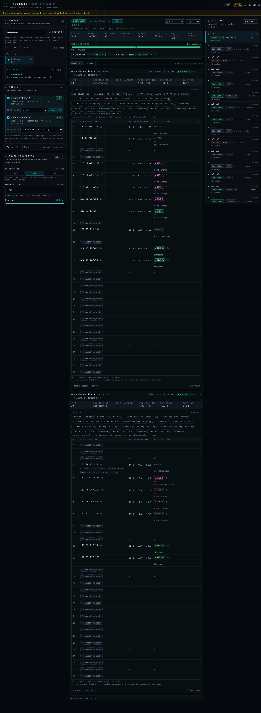

Protocol selector + destination port + per-node interface dropdowns before
starting the TCP run:

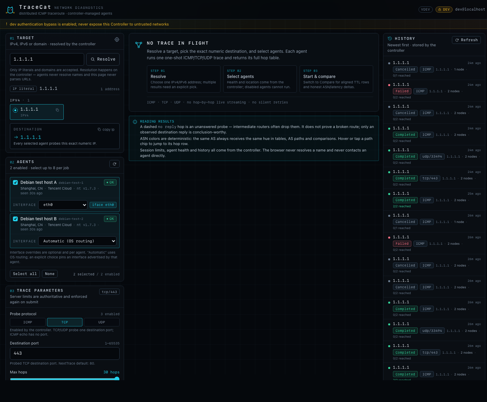

UDP/33494 run and the 390 px mobile layout:

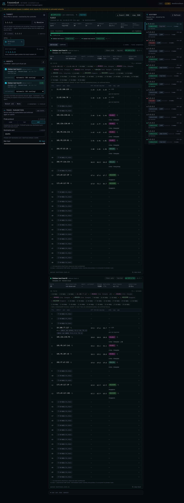

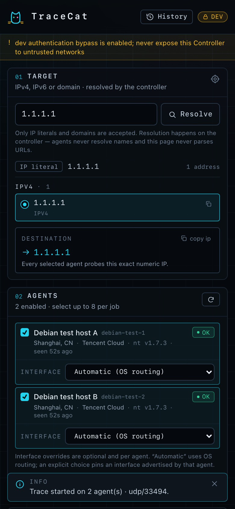

Machine-readable report: `verify/screenshots-v011/browser-report.json`.

### 13.6 Residual risks and notes for v0.1.1

- **Release-asset download path**: exercised post-tag by the Lead (§13.10);
  checksums, artifact layout, bundled installer hash and the published binary
  were verified. A full standalone `install.sh` run directly from the GitHub
  release URL could not be completed inside the verification environment
  because cross-border asset downloads were extremely slow; the identical
  installer code path was fully exercised offline (61 checks). Operators on
  normal networks should expect the documented one-command behaviour.
- Cloudflare Access mode remains code-reviewed only (no CF account/tunnel in the
  verification environment); dev/local were deployed.
- The browser proof still uses the loopback tunnel origin (`18090`); the
  `Secure`-cookie path on a real HTTPS origin is unit-tested, not observed.
- Tailnet ACLs are still not applied in this test environment; the bearer token
  remains the only application-layer authentication between Controller and
  Agents here.
- Providers may filter TCP/UDP responses; a `no_reply` hop is reported honestly
  and is not a failure (the TCP/UDP destination still completed in these runs).
- TCP/UDP use `CAP_NET_RAW` (ambient) exactly like ICMP; interface pinning maps
  to a fixed `-D <name>` pair and is revalidated against the Agent's live list.
- The 3 SKIPs remain informational/N/A (provider ICMP-filter capability probe,
  documented bind-matrix environment note, and the deferred release-asset
  download check).

### 13.7 Reproducing this delta

```bash
# build local release artifacts (no Node needed; dashboard assets committed)
scripts/build-release.sh 0.1.1 amd64

# full stack (new schema) on the Debian host
TESTHOST=root@124.222.154.86 verify/setup-testhost-fullstack.sh
TESTHOST=root@124.222.154.86 verify/setup-testhost-agent.sh

# host-side suites
scp verify/agent-remote-verify.sh verify/controller-remote-verify.sh \
    verify/installer-remote-verify.sh verify/check_trace_response.py \
    verify/check_argv.py root@HOST:/root/tc-verify/
ssh root@HOST 'bash /root/tc-verify/agent-remote-verify.sh'
ssh root@HOST 'bash /root/tc-verify/controller-remote-verify.sh'
ssh root@HOST 'bash /root/tc-verify/installer-remote-verify.sh'   # stops/restores installer services

# browser proof (from the Mac, after restoring the stack)
ssh -N -L 18090:127.0.0.1:8080 root@HOST &
"/Applications/Google Chrome.app/Contents/MacOS/Google Chrome" --headless=new \
  --remote-debugging-port=9334 --user-data-dir=/tmp/tc-verify-chrome-v011 \
  --no-first-run --no-default-browser-check --disable-gpu --no-proxy-server about:blank &
CDP_PORT=9334 APP_URL=http://127.0.0.1:18090/ OUT_DIR=verify/screenshots-v011 \
  node verify/e2e/drive-v011.mjs
```

Expected: agent `SUMMARY: 174 PASS, 0 FAIL, 2 SKIP`,
controller `SUMMARY: 155 PASS, 0 FAIL, 0 SKIP`,
installer `SUMMARY: 61 PASS, 0 FAIL, 1 SKIP`,
browser `SUMMARY 18/18 browser checks passed`.
The normal two-Agent + Controller stack is left running at the end.

### 13.10 Post-tag release-asset smoke (Lead, v0.1.1)

Verified after publishing https://github.com/dotfrankruan/TraceCat/releases/tag/v0.1.1 (tag commit `4ad5cdc`, including the release-workflow fix):

| Check | Result |
| --- | --- |
| Release assets present | PASS — `checksums.txt`, controller/agent `linux-amd64` + `linux-arm64` tarballs (5 assets) |
| SHA-256 of downloaded amd64 tarballs vs `checksums.txt` | PASS — both `OK` |
| Tarball `VERSION` | PASS — `v0.1.1` |
| Bundled `install.sh` hash equals repo `deploy/install.sh` | PASS — `e02a1b20d6d4…a7d040` on both |
| Published linux/amd64 agent binary runs on the Debian 13 test host | PASS — `tracecat-agent v0.1.1 (commit 4ad5cdc3a6fd, built 2026-10-28T15:59:36Z)` |
| Release workflow | PASS — the `Release` workflow completed and attached all assets (an initial run failed because a cleanup glob removed the tarballs before checksums; fixed in `4ad5cdc`) |

Caveat: the standalone installer *download* path was additionally exercised
manually at the asset level (download, checksum, extraction, binary execution);
the full `install.sh agent --version 0.1.1 ...` run over the release URL was not
completed in this environment because cross-border downloads from GitHub were
extremely slow. The installer itself (same file hash) passed all 61 offline
installer checks in §13.5.

## 14. v0.1.2 delta verification — automatic Agent enrollment

### 14.1 Scope and verified SHA

Delta verification of automatic Agent enrollment (no Controller machine list):
an Agent installed with `--controller <url>` + enrollment-token env registers
itself, receives a per-Agent trace token, appears in the dashboard and is
immediately usable.

| Item | Value |
| --- | --- |
| Verified HEAD | `23a056e` (`installer: print enrollment command on one copy-pasteable line`); enrollment feature commits `d750f2d` (Controller endpoint), `93d83cf` (Agent client/rotation), `4ec4d06`/`eb...` (installer/docs) |
| Installer SHA | `deploy/install.sh` `c5adb2e0a723418e3eaf3056b48697f410b5fdb3a0aaa5ea2b699cff94d772ee` |
| Artifacts | local release build `scripts/build-release.sh 0.1.2 amd64`: agent `3c75d3a22a081ac6…`, controller `3f624b029115e4da…` (VERSION=0.1.2), checksums verified; installed via the shipped installer with `--tarball/--checksums` |
| Host | Debian 13, systemd 257, NextTrace v1.7.3; enrollment Controller on `127.0.0.1:8082`, auto Agent on `127.0.0.1:8446`, temp validation Controllers on `8083/8084`, temp Agent on `8447` |
| Totals | **92 PASS / 0 FAIL** — enrollment suite **80 PASS / 0 FAIL** + browser **12/12 PASS** (0 console errors, 0 CSP violations, 0 uncaught exceptions) |
| Defects | **none in production code** (see 14.3 for two harness/UX observations) |

### 14.2 What was verified

| Area | Evidence (80 host checks + 12 browser checks, all PASS) |
| --- | --- |
| Controller install with `--enrollment` | zero static `--agent` entries accepted; `enrollment.enabled=true`, `token_env=TRACECAT_ENROLLMENT_TOKEN`, `refresh_after_seconds=300`; 43-char token generated into `/etc/tracecat/controller.env` (0600), printed once with a single copy-pasteable Agent command; secret not in JSON; `/nodes` starts empty; enrollment endpoint rejects browser session/CSRF-only requests (`401`) |
| Agent install with `--controller` | generated config has `"auth": {}` + `controller{url, enrollment_token_env, advertise_url, refresh_seconds}`; enrollment secret only in `/etc/tracecat/agent.env` (0600, no static `TRACECAT_AGENT_TOKEN`); starts, enrolls, logs `agent enrolled with controller` (node id only) |
| Auto registration contract | `/nodes` shows `source=auto`, `health=ok`, correct id/name, NextTrace version and interfaces; no URL/token fields; issued 43-char Agent token is persisted and authenticates `/v1/health` (`200`); unauthenticated inbound remains `401` |
| Real traces through the auto node | ICMP to `1.1.1.1` completed with hops and no port; TCP/443 completed with `protocol=tcp port=443` and hops; per-node interface selection (`eth0`) still honored (`interface=eth0`) |
| Token rotation / persistence | Agent restart re-enrolls and rotates the issued token; previous token rejected by the Agent (`401`), new token accepted (`200`); Controller restart reloads the persisted auto node + token from SQLite and the node returns healthy; periodic refresh (60 s test cadence) rotates the token on schedule |
| Negative/security matrix | wrong/missing Bearer `401`; enrollment disabled `404`; malformed JSON / unknown field / wrong schema / invalid node id / missing name `400`; oversized body `413`; advertised-URL matrix (`http` public, hostname `http`, credentials, query, path, fragment, `ftp`) `400`; static node-id collision `409`; rate limit `429` with `Retry-After`; rejected requests never register; static id can never be shadowed by auto |
| Legacy/static regression | static `--agent` Controller still serves `source=static`, `health=ok`, and completes a real ICMP job; TCP/UDP/interface behavior unchanged (see T checks) |
| Secret hygiene | enrollment secret and issued Agent tokens absent from Controller/Agent journals, `/api/v1/nodes` and job export; Controller/Agent env files 0600; SQLite database 0600; token column confirmed in `registered_agents` (documented residual risk) |
| Browser (headless Chrome over tunnel) | dashboard shows the automatically registered node without any Controller edit; health badge OK; no machine-list text; live recovery after `systemctl restart tracecat-agent` **without a page reload** (marker preserved); a UI-started ICMP trace completed with hop rows; 390 px layout, 0 CSP/console/exception errors |

### 14.3 Observations (no production defect)

1. **Node-identity binding is enforced** (correct security behaviour): the
   Controller rejects an Agent whose `/v1/health` `node_id` does not match the
   configured id (`agent health response does not match the node`). This first
   tripped my static-regression probe because it reused the auto node's id with
   a different static label; re-running with the real id passed. Worth keeping:
   it prevents URL/token confusion and proves static/auto identity integrity.
2. **Dashboard does not render the `source` field**: `/nodes` exposes
   `source=auto|static`, but the Agent card shows only name/id/health/NextTrace
   version; there is no visible "auto" badge. The user-visible requirement
   (node appears automatically) is met; a "discovered automatically" badge
   would be a small UX addition, not a defect.
3. **Provider network caveat**: from this host `raw.githubusercontent.com` timed
   out and GitHub release assets transferred at ~10 KB/s, so the one-line
   `curl | bash` download path could not be exercised here; the same installer
   driven with `--tarball/--checksums` (identical code after preparation) was
   used instead.

### 14.4 Results (enrollment suite: 80 PASS / 0 FAIL)

| Section | Checks | Result |
| --- | --- | --- |
| P0 prepare (stop stack, back up DB/configs) | 1 | PASS |
| C Controller `--enrollment` install (token, config, service, no machine list) | 14 | PASS |
| A Agent `--controller` install + auto registration | 13 | PASS |
| T real ICMP/TCP/interface traces through auto node | 7 | PASS |
| L token rotation, re-enroll, Controller-restart persistence, periodic refresh | 9 | PASS |
| N negative/security matrix (auth, body, URL, collision, rate limit, disabled) | 27 | PASS |
| X secret hygiene (journals, API, export, file modes, SQLite) | 7 | PASS |
| cleanup (DB restored, test ports closed) | 2 | PASS |
| **Total** | **80** | **0 FAIL** |

Browser proof — 12/12 PASS:

{bt}

### 14.5 Residual risks

- **Shared enrollment secret**: one high-entropy secret authorises any Agent
  that can reach the Controller. Compromise means an attacker can register a
  rogue Agent (which still only receives a per-Agent inbound token and must be
  reachable by the Controller). Rotation is "restart the Controller with a new
  token env value"; there is **no online rotation or revocation endpoint** in
  this revision, so rotating invalidates re-enrollment for all Agents until
  they receive the new secret.
- **Auto-registered Agent tokens are stored raw** in the Controller's 0600
  SQLite database (needed to call the Agents). Same trust boundary as the
  Controller host, but backups of `/var/lib/tracecat/controller.db` contain
  live Agent credentials.
- There is **no admin UI/API to revoke or disable an auto-enrolled node** yet;
  deleting its `registered_agents` row (or rotating the enrollment secret and
  removing the row) is the operational workaround.
- Enrollment is exposed wherever the Controller listens; keep it on a private
  overlay/VPC (or behind Cloudflare tunnel) and rate limits (30/min per IP,
  120/min global) are the only anti-guessing control.
- Static and auto modes coexist by design: static entries win on id collision;
  a static node whose id matches an auto registration keeps the static URL and
  token.

### 14.6 Commands used

```bash
# Controller (prints token + Agent command)
bash /root/tc-verify/enroll-install.sh controller --enrollment --auth dev \
  --listen 127.0.0.1:8082 --public-origin http://127.0.0.1:18090 \
  --tarball dist/tracecat-controller-linux-amd64.tar.gz --checksums dist/checksums.txt --force

# Agent (copied from the Controller output, with the token env prefixed)
TRACECAT_ENROLLMENT_TOKEN='<printed token>' \
  bash /root/tc-verify/enroll-install.sh agent --controller http://127.0.0.1:8082 \
  --listen 127.0.0.1:8446 --nexttrace /usr/local/bin/nexttrace \
  --tarball dist/tracecat-agent-linux-amd64.tar.gz --checksums dist/checksums.txt --force

# harness
scp verify/enrollment-remote-verify.sh root@HOST:/root/tc-verify/
ssh root@HOST 'bash /root/tc-verify/enrollment-remote-verify.sh'        # 80 PASS / 0 FAIL
CDP_PORT=9335 APP_URL=http://127.0.0.1:18090/ OUT_DIR=verify/screenshots-v012 \
  node verify/e2e/drive-v012-enroll.mjs                                # 12/12 PASS

# restore the previous two-Agent + Controller stack
ssh root@HOST 'rm -f /etc/tracecat/agent.env /etc/tracecat/agent-b.env /etc/tracecat/controller*.env'
TESTHOST=root@124.222.154.86 verify/setup-testhost-fullstack.sh
TESTHOST=root@124.222.154.86 verify/setup-testhost-agent.sh
```

### 14.7 Screenshots (`verify/screenshots-v012/`)

Automatically enrolled node with a completed UI-started ICMP trace:

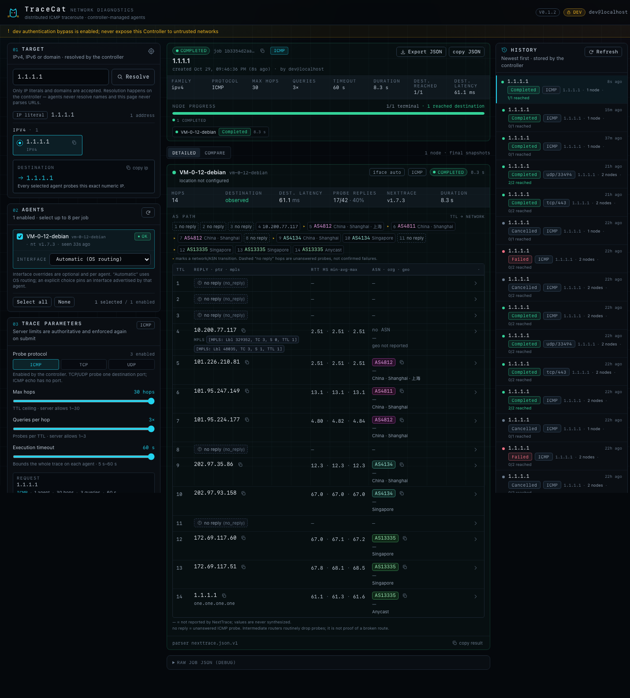

Dashboard before selection (only the self-registered node, no machine list):

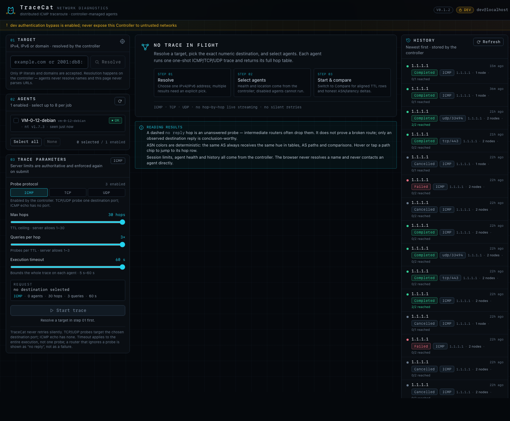

Live recovery after Agent restart without a page reload:


